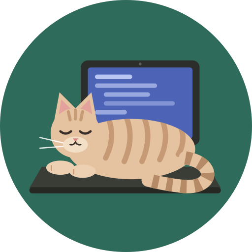

<p align="center">
  
</p>

# CatSpec

**Specs that check the code.** CatSpec links your Markdown specs to real classes and methods,
checks them on every commit, and lets AI agents verify their own work before they say "done".

> **Status: design stage.** CatSpec isn't implemented yet. This README describes the planned
> MVP (v0.1) so developers can review how it will be used. Commands and file formats may still
> change. Design documents: [analysis](docs/spec/reactive-ast-linked-spec-engine/analysis.md) ·
> [spec](docs/spec/reactive-ast-linked-spec-engine/spec.md) ·
> [plan](docs/spec/reactive-ast-linked-spec-engine/plan.md) ·
> [features](docs/spec/reactive-ast-linked-spec-engine/features/) ·
> [ADR log](docs/architecture/adr/reactive-ast-adr.md).

---

## Why

In spec-driven development (OpenSpec, Spec Kit, custom skills) the spec is just text. An agent
reads it, writes code and says it's done, and nothing checks that. A month later someone renames
a method and the spec is quietly wrong.

CatSpec turns the checkable part of a spec into **contracts**:

- *"class `AuthService` exists and has `login`, `logout`, `validateToken`"*
- *"`UserUpdatedHandler` implements `IMessageHandler<UserUpdatedEvent>`"*
- *"`src/Domain/**` must not import `src/Infrastructure/**`"*

It checks them against the code's syntax tree (via Tree-sitter, with no compiler needed), and:

| Where | What CatSpec does |
|---|---|
| **Your agent** (Claude Code, Cursor, Windsurf) | tells it what to build, checks its work, and won't let it stop while checks fail |
| **Every commit** (pre-commit hook) | blocks commits that break a contract that already passed |
| **Renames** | finds renamed or moved classes and updates the specs for you |
| **Your workflow** | plugs into OpenSpec, Spec Kit or your own skills, without replacing them |

CatSpec never writes specs or code itself, and it never calls an AI. Your agent does the
creative work; CatSpec checks the result. Checks give the same answer every time.

Languages in v0.1: **TypeScript** and **C#**.

---

## Install

```bash
npm install --save-dev catspec        # or run without installing: npx catspec <command>
npx catspec init --hooks --agents
```

`init` creates:

```
catspec.yaml                               # config
docs/architecture/adr/<name>-adr.md      # architecture decisions + repo-wide rules
docs/spec/<feature>/                       # one folder per feature / epic
  spec.md  plan.md                         # your human docs
  <spec-id>.spec.md                        # machine-checkable specs
.git/hooks/pre-commit                      # with --hooks (works with husky / lefthook too)
AGENTS.md block + .claude/settings.json    # with --agents (see "Use it with an AI agent")
```

If your repo already uses OpenSpec, Spec Kit or `sdd-*` skills, `init` detects it and suggests the
matching workflow preset.

---

## Write a spec

A spec is Markdown with a YAML header. The header is what CatSpec checks; the body is for people
and agents.

`docs/spec/user-auth/user-auth-service.spec.md`:

```markdown
---
catspec: 1
id: user-auth-service
type: feature
status: ready
depends_on: [database-schema]
bindings:
  - id: auth
    symbol: AuthService
    kind: class
    file: src/services/AuthService.ts        # a hint; moving the file doesn't break the spec
    members:
      - login
      - logout
      - name: validateToken
        params: [string]
        returns: "Promise<boolean>"
rules:
  - id: no-console
    class: structural
    forbid_call: "console.*"
    within: auth
---

# User authentication service

## Contracts
- [binding:auth] `AuthService` provides login, logout and token validation.
- [rule:no-console] No direct console logging; use `IAuthLogger`.

## Tasks
- [ ] Scaffold `AuthService`
- [ ] Implement JWT validation
```

For code that already exists, `catspec bind AuthService --spec user-auth-service` writes the
binding for you.

---

## Run it manually

```bash
catspec check                          # check everything: specs, contracts, drift
catspec check --spec user-auth-service # one spec, with a fix list ending in DONE / NOT DONE
catspec check --specs-only             # only the spec files (format, ids, dependencies), fast
catspec list --ready                   # specs whose dependencies are done
catspec graph --format mermaid         # dependency graph
catspec coverage                       # how much of the specs is actually enforced and passing
```

Example output:

```
✖ user-auth-service  docs/spec/user-auth/user-auth-service.spec.md:12
  CS0203 Member 'validateToken' missing in AuthService; did you mean 'checkToken'?
         src/services/AuthService.ts:21:3
1 error in 1 spec (204 ms)
```

**Status and lifecycle.** `draft → ready → in-progress → implemented → deprecated`

```bash
catspec status user-auth-service in-progress   # refused while depends_on aren't implemented
catspec status user-auth-service implemented   # refused while any contract fails
```

How strict the commit hook is depends on the status:
- **in-progress** specs only warn about unfinished parts. Breaking something that already passed is an error.
- **implemented** specs are fully enforced.

**Renames and refactoring**

```bash
catspec sync                 # show detected renames / moves and the spec edits they need
catspec sync --apply         # apply them

catspec refactor --scope "src/accounts/**"   # before a big refactor: take a snapshot
# … rename / move many classes in your IDE …
catspec sync --apply                          # map all old → new names at once, end the refactor
catspec refactor status | abort
```

**Intentional signature changes:** `catspec accept <spec-id>`. To rebuild all lock files:
`catspec baseline --rebuild`.

---

## Use it with an AI agent

The goal is that **the developer doesn't type `catspec` commands**: the agent runs them, and hooks
make sure it doesn't skip any.

### 1. Connect the MCP server

```bash
claude mcp add catspec -- npx catspec mcp      # Claude Code, from the repository folder
```

Other clients start the same command. Give the repository with `--cwd`, since they don't start it
in the project folder:

| Client | Config file | Entry under `mcpServers` |
|---|---|---|
| Claude Desktop | `claude_desktop_config.json` | `"catspec": { "command": "npx", "args": ["catspec", "--cwd", "/path/to/repo", "mcp"] }` |
| Cursor | `.cursor/mcp.json` in the repository | `"catspec": { "command": "npx", "args": ["catspec", "--cwd", "${workspaceFolder}", "mcp"] }` |
| Windsurf | `~/.codeium/windsurf/mcp_config.json` | `"catspec": { "command": "npx", "args": ["catspec", "--cwd", "/path/to/repo", "mcp"] }` |

The agent gets tools such as `get_spec_context`, `check_compliance`, `next_step`,
`start_stage` and `finish_stage`.

### 2. Tell the agent the rules, once

`catspec init --agents` adds this block to `AGENTS.md` (Claude Code reads it via `CLAUDE.md`):

```markdown
<!-- catspec:begin -->
## CatSpec workflow (agents must follow)
For every work item (PBI) `<id>` you work on:
1. Before coding run `catspec stage start task <id>`. If it fails, stop and report why.
2. After each change run `catspec check --spec <id>` and fix everything it reports, until it says DONE.
3. When all tasks in `<id>.spec.md` are ticked, run `catspec stage finish task <id>`,
   then `catspec stage finish close <id>`.
4. Never weaken a contract in a `*.spec.md` to make a check pass. Ask the developer instead.
<!-- catspec:end -->
```

You write this once, not in every `tasks.md`.

### 3. Make it reliable with hooks

Agents usually follow instructions, but not always. Two hooks close the gap:

| Hook | Runs | Effect |
|---|---|---|
| Claude Code `Stop` hook | `catspec check --in-progress --format agent` | while an in-progress item fails, the agent can't finish its turn and gets the fix list |
| git pre-commit | `catspec check --staged` | no commit can break a contract |

`init --agents` merges the Stop hook into `.claude/settings.json`:

```json
{
  "hooks": {
    "Stop": [
      { "hooks": [ { "type": "command", "command": "npx catspec --cwd \"$CLAUDE_PROJECT_DIR\" check --in-progress --format agent" } ] }
    ]
  }
}
```

If the agent fails 3 times in a row with the same errors, CatSpec lets it stop and tells you the
item is stuck, so it can't loop forever.

### What a session looks like

```
you:    /sdd-task register-api
agent:  catspec stage start task register-api      → dependencies OK, status in-progress
agent:  (writes code) → catspec check --spec register-api
        ✖ CS0203 expected method 'login', found 'signIn'
agent:  (renames) → catspec check --spec register-api → DONE
agent:  catspec stage finish task register-api      → passes
agent:  catspec stage finish close register-api     → tasks ticked, no drift → implemented
agent:  "register-api is done."                     → Stop hook: check passes, agent may stop
you:    review the diff, commit                      → pre-commit hook: passes
```

---

## Plug into your SDD workflow

Tell CatSpec how your repo plans work, in `catspec.yaml`. CatSpec then knows the steps, tells the
agent what's next, and checks each step when it starts and finishes.

**OpenSpec or Spec Kit:** one line.

```yaml
workflow:
  preset: openspec      # or: spec-kit
```

**Your own skills** (example: `sdd-spec`, `sdd-plan`, `sdd-task`, `sdd-close`):

```yaml
workflow:
  preset: custom
  feature_dir: "docs/spec/{feature}"
  skills_dir: ".claude/skills"
  stages:
    - id: spec                       # once per epic
      per: feature
      driver: { skill: sdd-spec }
      produces: ["{feature_dir}/spec.md", "{feature_dir}/*.spec.md"]
      finish: { gates: [specs_valid, artifacts, contracts_declared] }
    - id: plan
      per: feature
      driver: { skill: sdd-plan }
      produces: ["{feature_dir}/plan.md"]
      finish: { gates: [artifacts, deps_known], status: ready }
    - id: task                       # once per PBI
      per: spec
      driver: { skill: sdd-task }
      start:  { gates: [deps_ready], status: in-progress }
      finish: { gates: [contracts_pass] }
    - id: close
      per: spec
      driver: { skill: sdd-close }
      finish: { gates: [contracts_pass, tasks_done, no_drift], status: implemented }
```

```bash
catspec workflow doctor            # are the skills there? does the config match the repo?
catspec workflow show [feature]    # where each feature / PBI is
catspec workflow snippet task      # the 2 lines to paste into your sdd-task skill
catspec next <feature>             # what to do next, and with which skill
```

With `preset: openspec` the stages are `proposal`, `apply` and `archive`, driven by OpenSpec's
`/opsx:propose`, `/opsx:apply` and `/opsx:archive`. With `preset: spec-kit` they are `specify`,
`plan`, `tasks` and `implement` (`/speckit.*`).

If a gate blocks a step and you know why, `catspec stage start|finish … --force` goes ahead with a
warning and logs the override in `.git/catspec/workflow-overrides.log`. It still never marks a spec
`implemented` while its contracts fail, and agents can't force a step over MCP.

### Example: an epic with features, PBIs and tasks

```
docs/spec/user-account-management/            # epic
  spec.md  plan.md
  registration.spec.md        # feature: groups PBIs   depends_on: [register-api, email-verification]
  register-api.spec.md        # PBI (its tasks are the "## Tasks" checklist inside)
  email-verification.spec.md  # PBI   depends_on: [register-api]
  login.spec.md               # feature                depends_on: [login-api, token-refresh]
  login-api.spec.md           # PBI   depends_on: [register-api]
  token-refresh.spec.md       # PBI   depends_on: [login-api]
```

```bash
# Epic: spec and plan (run by /sdd-spec and /sdd-plan)
catspec stage start  spec user-account-management
catspec stage finish spec user-account-management    # specs valid, files exist
catspec stage start  plan user-account-management
catspec stage finish plan user-account-management    # → all specs "ready"

# Which PBI can start?
catspec next user-account-management                 # → register-api (others wait on it)

# Each PBI (run by /sdd-task and /sdd-close, or by the agent per AGENTS.md)
catspec stage start  task  register-api              # → in-progress
catspec check --spec register-api                    # repeat until DONE
catspec stage finish task  register-api
catspec stage finish close register-api              # → implemented
# now email-verification and login-api are ready (they can run in parallel, on two branches)

# Features, then the epic
catspec stage finish close registration              # passes once both its PBIs are implemented
catspec stage finish close login
catspec stage finish close user-account-management   # re-checks every spec; the epic is done
```

---

## Command reference (v0.1)

| Command | Purpose |
|---|---|
| `init [--preset p] [--hooks] [--agents]` | set up the repo |
| `install-hooks` / `uninstall-hooks` | git pre-commit hook (husky / lefthook aware) |
| `mcp` | start the MCP server for agents |
| `check [paths] [--spec id] [--specs-only] [--staged] [--in-progress] [--format text\|json\|agent]` | the one validation command |
| `list [--status s] [--ready]` · `show <spec>` · `graph` · `coverage` | inspect specs and progress |
| `bind <symbol> --spec <id>` | create a binding from existing code |
| `status <spec> <status> [--force]` | change lifecycle status (with checks) |
| `accept <spec>` · `baseline --rebuild` | accept intentional signature changes · rebuild lock files |
| `sync [--apply] [--map f]` | fix spec locations after renames / moves |
| `refactor [--scope g]` · `refactor status` · `refactor abort` | large refactors |
| `next <feature>` · `stage start\|finish <stage> <feature\|spec> [--force]` | workflow steps |
| `workflow show\|doctor\|snippet` | workflow profile tools |

Exit codes: `0` ok, `1` errors, `2` usage or config error, `3` internal error. With `--format agent`:
`0` done, `2` not done (blocks the agent), `1` error.

---

## Limits (v0.1)

- **Structure, not behaviour.** CatSpec checks names, members, signatures, interfaces, imports and
  calls. Behaviour ("must be idempotent") needs a linked test, or stays a tracked `manual` invariant.
- **Syntax only.** No type resolution across files: inheritance chains and aliases aren't followed.
  When something can't be decided, CatSpec says so instead of guessing.
- **No agent locks.** Parallel agents use git branches; `catspec check` after a merge catches broken
  contracts. Locks are planned for later (ADR-014).
- **Local only.** CI integration (SARIF, PR comments) and the GitHub App come after v0.1.

---

## Contributing

This repo is developed spec-first. Read [`AGENTS.md`](AGENTS.md) for where docs and decisions live,
the [ADR log](docs/architecture/adr/reactive-ast-adr.md) for architecture decisions, and the
[design documents](docs/spec/reactive-ast-linked-spec-engine/).

## License

[Apache-2.0](LICENSE)
