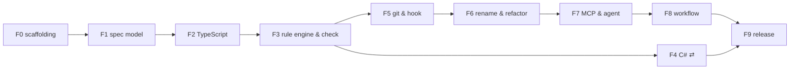

# CatSpec — Plan (MVP v0.1): how and in what order

> Implements [`spec.md`](./spec.md) (what and why). This plan is the **how**:
> - **Part I — Delivery:** principles, progress, features and their order, working rules.
>   Each feature has its own file in [`features/`](./features/) with its description, Gherkin
>   acceptance criteria, Definition of Done, PBIs and tasks.
> - **Part II — Technical design** (`§Dn`): formats, CLI, engine, git hook, MCP and workflow
>   profiles. The section numbers continue those of the former single spec (ADR-018).
>
> Findings `F-n` are in [`analysis.md`](./analysis.md); decisions are in the
> [ADR log](../../architecture/adr/reactive-ast-adr.md). Estimates assume one experienced
> TypeScript engineer; parallelisable work is marked ⇄.

# Part I — Delivery

## 0. Principles

- **Vertical slices early.** By the end of F3 one language works end-to-end
  (spec → check → diagnostics); everything after adds depth.
- **Facts, not trees.** Adapters turn Tree-sitter trees into `FileFacts`; the rule
  engine never sees grammar nodes. Rules are tested with hand-written facts, adapters with golden files.
- **Dogfooding.** From F3 the CatSpec repo has its own machine specs in `docs/spec/<feature>/` (see `AGENTS.md`) describing its
  packages (TypeScript adapter), and `catspec check` runs in the repo's own CI.
- **Every feature ends releasable** (`0.0.x` pre-releases on npm under `next`).

## 1. Progress

Tick a feature only when every item of its feature checklist (in its feature file) is done
**and the owner approved ticking it** (`AGENTS.md` Rule 3). PBI and task progress is tracked
in the feature files.

- [x] F0 [`repo-scaffolding`](./features/repo-scaffolding.md)
- [x] F1 [`spec-model`](./features/spec-model.md)
- [x] F2 [`typescript-language-support`](./features/typescript-language-support.md)
- [ ] F3 [`rule-engine-and-check`](./features/rule-engine-and-check.md)
- [ ] F4 [`csharp-language-support`](./features/csharp-language-support.md)
- [ ] F5 [`git-integration-and-hook`](./features/git-integration-and-hook.md)
- [ ] F6 [`rename-and-refactor`](./features/rename-and-refactor.md)
- [ ] F7 [`mcp-server-and-agent-layer`](./features/mcp-server-and-agent-layer.md)
- [ ] F8 [`workflow-profiles`](./features/workflow-profiles.md)
- [ ] F9 [`release-0-1`](./features/release-0-1.md)

## 2. Features

| # | Feature | Weeks | Depends on | Acceptance |
|---|---|---|---|---|
| F0 | [`repo-scaffolding`](./features/repo-scaffolding.md) | 0.5 | — | `@AC-F0-1..2` |
| F1 | [`spec-model`](./features/spec-model.md) | 1.5 | F0 | `@AC-F1-1..4` |
| F2 | [`typescript-language-support`](./features/typescript-language-support.md) | 1.5 | F1 | `@AC-F2-1..3` |
| F3 | [`rule-engine-and-check`](./features/rule-engine-and-check.md) | 1.5 | F2 | `@AC-F3-1..5` (spec AC-1, AC-6, AC-7) |
| F4 | [`csharp-language-support`](./features/csharp-language-support.md) ⇄ | 1.5 | F3 | `@AC-F4-1..3` (spec AC-1, AC-6 on C#) |
| F5 | [`git-integration-and-hook`](./features/git-integration-and-hook.md) | 1.5 | F3 | `@AC-F5-1..4` (spec AC-4, AC-5) |
| F6 | [`rename-and-refactor`](./features/rename-and-refactor.md) | 1.5 | F5 | `@AC-F6-1..4` (spec AC-2, AC-3, AC-11, AC-12) |
| F7 | [`mcp-server-and-agent-layer`](./features/mcp-server-and-agent-layer.md) | 1 | F6 | `@AC-F7-1..4` (spec AC-9, AC-10, AC-17) |
| F8 | [`workflow-profiles`](./features/workflow-profiles.md) | 1 | F7 | `@AC-F8-1..3` (spec AC-14, AC-15, AC-16) |
| F9 | [`release-0-1`](./features/release-0-1.md) | 1 | F4, F8 | `@AC-F9-1..3` (all MVP spec AC) |



Total: **~12.5 weeks** for one engineer (≈11 with F4 in parallel).

Critical path: F0 → F1 → F2 → F3 → F5 → F6 → F7 → F8 → F9. F4 can run in parallel
with F5–F6 if a second person is available.

## 3. How to work

`§Dn` = Part II of this plan (technical design); `spec §n` = [`spec.md`](./spec.md); `F-n`, `C-n` = [`analysis.md`](./analysis.md); `ADR-n` = the ADR log.

### Rules

- **Order.** Work feature by feature. Inside a feature, take any PBI whose `depends on` PBIs are done.
  ⇄ marks work that can run in parallel with the critical path.
- **IDs.** Every feature and PBI has a stable kebab-case id. These become the machine spec ids
  (`<id>.spec.md` in the epic folder) once CatSpec can check itself. Features are *aggregate* specs
  over their PBIs (§D17.1).
- **Ask before deviating.** If the work needs behaviour, scope or order that differs from
  `spec.md`, this plan or a feature file, **ask first**: state the difference, give 2–3 proposals with
  a recommendation, and wait for the owner's approval before changing any of these files
  (`AGENTS.md` Rules 1.5 and 3). Architectural decisions go into the ADR log only after the same
  approval (`AGENTS.md` Rule 2).
- **Approvals.** No merge into `main` and no change to any `.md` file (including ticking
  boxes in this plan or in a feature file) without the owner's explicit approval (`AGENTS.md` Rule 3).
- **Bootstrapping.** Until PBI `dogfood-specs` (feature F3), CatSpec can't check itself yet, so the
  acceptance-coverage check (below) is the only gate. After that, each new PBI also gets its own
  `<id>.spec.md`, and CatSpec gates the work as well (`stage start` → `check --spec` → `stage finish`).

### Acceptance criteria (Gherkin)

- Every feature and every PBI has acceptance criteria written in **Gherkin**
  (`Scenario` / `Given` / `When` / `Then`, plus `And`).
  - **Feature scenarios** are end-to-end: they describe what a user sees.
  - **PBI scenarios** are narrower (unit or integration level).
- Every scenario has a unique tag:
  - `@AC-F<n>-<k>` for a feature scenario;
  - `@AC-<pbi-id>-<k>` for a PBI scenario.

  A scenario that implements one of the epic's scenarios also names it, e.g. `(spec AC-1)`.
- **Every scenario becomes an automated test** whose name starts with its tag in brackets, e.g.
  `it("[AC-check-command-1] reports a missing member with did-you-mean", …)`. Scenario text and test
  name must describe the same behaviour.

### Definition of Done

#### PBI checklist (applies to every PBI, in addition to its own tasks)

- [ ] every task of the PBI is done;
- [ ] every acceptance scenario of the PBI has a test tagged with its id, and **all tests pass**
      locally and in CI on Linux, and on macOS and Windows (PR labels `full-ci-mac` and `full-ci-win`)
      before the PBI is ticked;
- [ ] **requirements check:** the implementation was compared with every section the PBI
      cites (its `refs:` line). It does what they say, nothing is missing, and nothing was added beyond them.
      Any difference was raised with the owner and approved (Rule 3) before merging;
- [ ] no new lint or type errors; new diagnostics are in the code registry with docs text;
      CLI help and docs are updated;
- [ ] if the spec format changed: JSON Schema regenerated, and an ADR entry proposed and approved (Rule 2);
- [ ] the owner approved ticking the PBI's boxes in its feature file (Rule 3).

#### Feature checklist (repeated in each feature file)

- [ ] all PBIs of the feature meet the PBI checklist;
- [ ] every feature scenario is an automated end-to-end test, passing in CI on 3 OSes;
- [ ] requirements review: every item under "Requirements covered" was checked against the
      implementation, and differences were approved by the owner;
- [ ] (from F3 on) `catspec stage finish close <feature>` passes;
- [ ] the owner approved closing the feature and ticking it in §1 Progress.

#### How the Definition of Done is enforced

| Gate | From | What it blocks |
|---|---|---|
| **Acceptance-coverage check** in CI (PBI `ci-pipeline`) | F0 | A PBI whose boxes are all ticked, or a closed feature, that has a scenario with no test, or whose tagged test fails, fails CI. A test with a tag that isn't in any feature file also fails CI. |
| **PR template** with the PBI checklist (PBI `ci-pipeline`, created after owner approval) | F0 | Every PR states which PBIs it covers and ticks the checklist for review. |
| **Branch protection on `main`** (owner action) | F0 | PRs can't be merged while CI is red, and need the owner's approval. |
| **CatSpec checking itself** (PBI `dogfood-specs`) | F3 | `catspec check` in CI; `stage finish close` refuses while contracts fail or tasks are unticked. |

## 4. Risks

| Risk | Signal | Response |
|---|---|---|
| Tree-sitter WASM grammar build friction | F2 slips > 2 days | use prebuilt `tree-sitter-wasms` package as interim, pin version |
| C# syntax variety (primary ctors, file-scoped ns, source generators) | many golden failures | ship C# as "beta" in 0.1, document unsupported constructs, keep `unresolvable` diagnostics |
| YAML CST edge cases | round-trip failures | restrict writes to block-style sequences; refuse edit with clear message rather than corrupting |
| Hook perf on Windows (process spawn cost) | > 1 s | single long-lived `git cat-file --batch`, avoid `npx` resolution in hook by calling `node_modules/.bin/catspec` directly |
| MCP SDK API changes | breakage | pin SDK minor, adapter layer in `@catspec/mcp` |

## 5. Post-MVP roadmap (not estimated in detail)

| Version | Theme | Content |
|---|---|---|
| 0.2 | CI gate | `check --format sarif` (GitHub code scanning), `--format github` annotations, `catspec ci --base origin/main` (diff-aware), reusable GitHub Action, PR comment bot with drift explanations (source "Phase 3") |
| 0.3 | More languages & depth | Python adapter, Go adapter, `implements_transitive` via in-repo base resolution, optional semantic backend via LSP |
| 0.4 | Agent coordination | **Local claims** (§D9: `FsClaimStore` with O_EXCL leases in the git common dir, `claim/release/assign` with worktrees, hook enforcement `CS0501`, exclusive refactor claims `CS0503`, MCP `claim_spec`/`release_spec`; acceptance 8, 13); then `GitRefsClaimStore` (`refs/catspec/claims/*`, push = CAS), GitHub App: spec change / issue → DAG evaluation → create branch + issue + trigger agent workflow when unblocked; status sync with PR merge (source "Phase 4") |
| 0.5 | Visual & IDE | `graph --ui` local web server, VS Code extension consuming JSON diagnostics (inline spec ↔ code links) |
| later | Semantic invariants | optional LLM-judged `manual` rules producing *advisory* findings, never gating |

---

# Part II — Technical design

## D3. Repository layout

Default layout. CatSpec uses **feature folders**: every spec, and the human docs
that go with it, lives in a folder named after its feature (epic).

```
<repo>/
  catspec.yaml                          # config (§D4)
  docs/architecture/adr/
    <name>-adr.md                       # architecture spec, type: architecture (§D6.4):
                                        #   frontmatter = global rules, body = ADR log
  docs/spec/
    <feature>/                          # kebab-case full feature/epic name, e.g. react-sdd
      analysis.md                       # human docs (optional, opaque to the engine)
      spec.md
      plan.md
      tasks.md
      <spec-id>.spec.md                 # machine spec(s) of this feature (§D5)
      <spec-id>.lock.json               # generated, committed, next to its spec (§D7)
  <git-common-dir>/catspec/             # runtime, NOT committed
    cache/<blob-sha>.json
    refactor.json                       # active refactor baseline (§D11.8)
    claims/<spec-id>.json               # post-MVP (§D9)
```

- `catspec init` creates this layout, a starter `<name>-adr.md` (`<name>` = `--name` or the repo folder name, kebab-case), and, with `--with-sdd-example`, an example feature folder
  with `spec.md`, `plan.md` and one `*.spec.md`. `catspec init --agents` also appends
  the layout rules to `AGENTS.md` (created if missing) so coding agents follow them.
- `catspec check --specs-only` warns (`CS0106`) when a `*.spec.md` is outside `docs/spec/<feature>/`
  or sits deeper than one folder level, and when the architecture spec is not at the
  configured path. Teams with another layout set `layout: free` in the config.
- Human docs (`analysis.md`, `spec.md`, `plan.md`, `tasks.md`) never match the spec glob
  (`*.spec.md` requires the `.spec.md` suffix), so the engine ignores them.

---

## D4. Configuration — `catspec.yaml` (repo root)

```yaml
version: 1
layout: feature-folders  # feature-folders | free
workflow:
  preset: catspec        # catspec | openspec | spec-kit | custom; full schema in §D17
  allow_commands: false  # allow `command:` gates to run shell commands
  enforce_in_hook: warn  # off | warn | error
specs:
  include: ["docs/spec/*/*.spec.md"]
  architecture: "docs/architecture/adr/*-adr.md"   # exactly one match, else CS0107
languages:
  typescript:
    include: ["src/**/*.{ts,tsx}"]
    exclude: ["**/*.d.ts", "**/node_modules/**"]
  csharp:
    include: ["src/**/*.cs"]
    exclude: ["**/obj/**", "**/bin/**", "**/*.g.cs"]
enforcement:
  drift: warn            # off | warn | strict          (F-8)
  unresolvable: warn     # warn | error                 (F-5)
  unenforced_prose: warn # off | warn                   (F-2)
heal:
  mode: suggest          # off | suggest | auto         (F-7)
  threshold: 0.8
hook:
  stage_generated: true  # re-stage lock files / auto-healed specs
refactor:
  detect_threshold: 10   # broken bindings in one commit that count as a large refactor (§D11.8)
  allow_wip: false
mcp:
  allow_location_edits: true
  allow_contract_edits: false   # F-13
tests:
  command: ["npx", "vitest", "run", "-t", "{test}"]  # string or argv list; `{test}` = test name
```

`tests.command` is what `catspec check --run-tests` runs for each `test` rule (CS0621 on
failure). It is run with `execFile`, never through a shell; a string is split on whitespace.
`{test}` is replaced by the rule's test symbol. The test passes when the command exits with 0.

The config is validated with the same schema library as specs; a JSON Schema is
published for editor autocompletion. All keys have defaults; `catspec init`
writes a minimal file.

---

## D5. Spec file format — `*.spec.md`

### D5.1 Example

```markdown
---
catspec: 1
id: user-sync-handler
title: User sync handler
type: feature
status: in-progress
depends_on: [cdc-core-events]
owners: ["@team-identity"]
scope:
  - src/Services/Identity/Handlers/**
bindings:
  - id: handler
    symbol: Identity.Handlers.UserUpdatedHandler
    kind: class
    file: src/Services/Identity/Handlers/*.cs        # hint, optional
    implements: ["IMessageHandler<UserUpdatedEvent>"]
    constructor:
      requires: [ILogger, IEventStore]
    members:
      - name: HandleAsync
        kind: method
        params: [UserUpdatedEvent, CancellationToken]
        returns: Task
        modifiers: [public]
rules:
  - id: no-console
    class: structural
    forbid_call: "Console.WriteLine"
    within: handler
  - id: idempotent
    class: test
    test: { symbol: UserUpdatedHandlerTests.HandleAsync_IsIdempotent, lang: csharp }
  - id: dedup-review
    class: manual
    text: Deduplication must use the message id, not the payload hash.
infrastructure:
  - resource: AzureServiceBus
    entity: "topic:user-events"
waivers: []
---

# User sync handler

## Contracts
- [rule:idempotent] `HandleAsync` must be idempotent.
- [binding:handler] Dependencies `ILogger` and `IEventStore` are injected.
- [rule:no-console] No direct console logging.

## Tasks
- [ ] Create a class implementing the bus handler interface.
- [ ] Add message de-duplication.
```

### D5.2 Frontmatter schema

| Field | Type | Req. | Notes |
|---|---|---|---|
| `catspec` | int | yes | schema version, `1` |
| `id` | string `^[a-z0-9][a-z0-9-]{1,63}$` | yes | unique across repo |
| `title` | string | no | defaults to first `#` heading |
| `type` | `feature \| component \| contract \| architecture \| adr` | yes | `architecture` makes rules global (§D6.4) |
| `status` | `draft \| ready \| in-progress \| implemented \| deprecated` | yes | human-owned lifecycle (§D8) |
| `depends_on` | string[] | no | spec ids; must exist, no cycles |
| `owners` | string[] | no | informational |
| `scope` | glob[] | no | extra paths that belong to this spec (lock scope, F-10) |
| `bindings` | Binding[] | no | §D5.3 |
| `rules` | Rule[] | no | §D6 |
| `infrastructure` | object[] | no | free-form, passed to agents, not validated (MVP) |
| `waivers` | Waiver[] | no | §D6.5 |
| `links` | `{ pr?, issue?, commit? }` | no | set by `mark_spec_resolved` |

Unknown top-level keys → warning `CS0102` (not error) so teams can add metadata.

### D5.3 Binding

| Field | Type | Notes |
|---|---|---|
| `id` | string | local id, unique in spec; referenced by rules (`within`) and prose (`[binding:id]`). Defaults to `symbol`'s last segment. |
| `symbol` | string | qualified name: C# `Namespace.Type[.Member]`, TS `path/to/module#Name[.member]` or bare `Name`. Matched by suffix (F-5). |
| `kind` | `class \| interface \| struct \| enum \| record \| function \| method \| type \| module` | |
| `lang` | language id | inferred from `file` or config when omitted |
| `file` | path \| glob \| list | **hint** (F-6). C# partial classes: all matches are merged. |
| `implements` | string[] | direct base types/interfaces (normalised suffix match) |
| `extends` | string | direct base class |
| `attributes` | string[] | C# attributes / TS decorators, e.g. `HttpGet("users")`, `Controller` — name match, args match if given |
| `constructor.requires` | string[] | types that must appear among parameters of at least one constructor (DI check) |
| `members` | (string \| Member)[] | string shorthand = name-only member of any kind |
| `exported` | bool | TS: must be exported; C#: must be `public` |

`Member`: `name`, `kind` (`method|property|field|event|constructor`), `params`
(type strings, positional; `"*"` = any), `returns`, `modifiers`
(`public|private|protected|internal|static|async|abstract|override|readonly`),
`attributes`, `optional` (bool, default false).

When `params`/`returns` are omitted, the member's shape is protected only by the
drift fingerprint (§D7.2), not by the contract.

### D5.4 Markdown body

Parsed with remark (mdast). The engine extracts:

- prose invariant references `[rule:<id>]`, `[binding:<id>]` — unknown ids → error `CS0110`;
- bullets under a heading named `Contracts` / `Invariants` that have **no** reference → `CS0111 unenforced prose invariant` (per `enforcement.unenforced_prose`);
- task checklist items (`- [ ]` / `- [x]`) under `Tasks` → progress `done/total`.

The body is otherwise opaque and returned verbatim to agents.

---

## D6. Rules (invariants)

### D6.1 Classes

| Class | Evaluated by | Blocks commit? |
|---|---|---|
| `structural` | rule engine on normalised symbols | yes (status-dependent, §D8) |
| `query` | raw Tree-sitter query on files in scope | yes |
| `test` | linked test symbol must exist; executed only with `--run-tests` | yes (existence) |
| `manual` | nobody; tracked | never |

### D6.2 Structural rule catalogue (MVP)

| Key | Meaning | Params |
|---|---|---|
| `forbid_call` | no call expression whose callee text matches | pattern (`*` wildcard), `within` |
| `require_call` | at least one matching call in the target | pattern, `within` (binding or member: `handler.HandleAsync`) |
| `forbid_import` | files matching `from` must not import modules matching `to` | `from` glob, `to` pattern(s) |
| `allow_import_only` | files in `from` may import only `to` patterns (+ stdlib) | |
| `naming` | symbols of `kind` matching `name` must satisfy `implements` / `extends` / `attributes` / `in_path` | |
| `must_not_exist` | a symbol pattern must not exist (deprecations) | `symbol`, `kind` |

Common rule fields: `id`, `class`, `message` (optional custom text), `adr` (ADR id the rule
enforces, §D6.4) and `paths` (glob list narrowing the files checked).
`within` scopes a rule to a binding (or `binding.member`); without it the scope is
the spec's resolved files. In `architecture` specs the default scope is all
configured sources.

### D6.3 `query` rules

```yaml
- id: no-sync-over-async
  class: query
  lang: csharp
  query: |
    (member_access_expression name: (identifier) @n (#eq? @n "Result")) @hit
  expect: absent          # absent | present
  within: handler
  message: "Do not block on Task.Result inside handlers."
```

Queries are compiled at load time; invalid query → `CS0130`.

### D6.4 Global rules (`docs/architecture/adr/<name>-adr.md`)

The architecture spec is a single file at `docs/architecture/adr/<name>-adr.md`
(configurable via `specs.architecture`). Its frontmatter holds the global rules;
its Markdown body is the project's Architecture Decision Record log (one
`## ADR-NNN: <title>` section per decision, append-only). Each global rule should
name the decision it enforces (`adr: ADR-003`); `catspec check --specs-only` reports unknown ADR ids (`CS0112`).

Rules in a `type: architecture` spec apply repo-wide and are checked on every
`check` (in `--staged` mode: on changed files only). Architecture specs have no
bindings requirement and no `in-progress` relaxation (always enforced unless `draft`).

### D6.5 Waivers

```yaml
waivers:
  - rule: no-console
    reason: "Bootstrap logging before DI container is built"
    until: 2026-12-31
    paths: ["src/Bootstrap/**"]   # optional narrowing
```

A waived diagnostic becomes `info` (`CS0400`); an expired waiver → error `CS0401`.

---

## D7. Lock file — `docs/spec/<feature>/<spec-id>.lock.json` (observed state)

Generated, deterministic (sorted keys, stable formatting), committed. One file
per spec, stored next to its `*.spec.md`, to minimise merge conflicts and keep a
feature folder self-contained. `catspec baseline --rebuild` regenerates all.

```json
{
  "spec": "user-sync-handler",
  "specHash": "sha256:…",
  "items": { "binding:handler": "sha256:…", "binding:handler.HandleAsync": "sha256:…" },
  "satisfied": ["binding:handler", "binding:handler.HandleAsync", "rule:no-console"],
  "symbols": {
    "handler": {
      "resolved": "src/Services/Identity/Handlers/UserUpdatedHandler.cs#Identity.Handlers.UserUpdatedHandler",
      "files": ["…"],
      "fingerprint": "sha256:…",
      "shape": { "kind": "class", "bases": ["IMessageHandler<UserUpdatedEvent>"], "members": ["HandleAsync(UserUpdatedEvent,CancellationToken):Task"] }
    }
  }
}
```

`items` holds the hash of each contract item as the spec declares it. `files` appears only when
a symbol spans several files (C# `partial` types). Only `in-progress` and `implemented` specs
have lock files; the architecture spec never does. A lock file that can't be read (for example
one with merge-conflict markers) is treated as missing and rebuilt, with no diagnostic. A lock
file without its spec is `CS0108`.

### D7.1 Ratchet (F-4)
Every check that writes lock files (the pre-commit hook, `catspec baseline --rebuild` and
`catspec accept`) adds the contract items it sees pass to `satisfied`; a plain `catspec check`
reads lock files but never writes them. Once satisfied,
a failure of that item is an **error** regardless of `in-progress` status. Items
leave `satisfied` only when removed from / changed in the spec (detected via `specHash`
per item).

### D7.2 Fingerprints & drift (F-8)
Shape = kind, normalised name, bases, attributes, member signatures (name, param
types, return type, modifiers). Bodies are excluded. For `implemented` specs, a
shape change → `CS0300 drift` (severity from `enforcement.drift`).
`catspec accept <spec-id>` records the new shape.

---

## D8. Lifecycle & enforcement matrix

```
draft ──► ready ──► in-progress ──► implemented ──► deprecated
                 ▲        │  (promote: all enforceable contracts pass)
                 └────────┘  (demote: allowed, manual)
```

| Item state \ Spec status | draft / ready | in-progress | implemented | deprecated |
|---|---|---|---|---|
| contract fails, never satisfied | — | warning | **error** | — |
| contract fails, previously satisfied | — | **error** (ratchet) | **error** | — |
| drift | — | info | per config | — |
| spec errors (schema, DAG; `check --specs-only`) | **error** | **error** | **error** | warning |

- `ready` requires all `depends_on` to exist; `in-progress` requires them to be **satisfied** (status `implemented` and passing), unless `--force`.
- `implemented` can only be set when the spec's enforceable contracts pass (CLI and MCP enforce this), and also requires the dependency gate.
- `--force` skips only the dependency gate (CS0502). It never lets `implemented` be set while contracts fail.

---

## D9. Claims (runtime locks) — F-10 · **post-MVP**

> **Deferred (ADR-014).** Claims are not part of the MVP. This section is kept as the design for
> a later release. In the MVP, parallel work is coordinated by git branches and worktrees as
> usual: conflicts surface at merge time, and `catspec check` after the merge catches any
> contract that the combined result breaks. Diagnostics `CS0500`, `CS0501` and `CS0503` are reserved.
> The specs' `scope` field is still parsed in the MVP, so the data claims need already exists.

Store: `<git-common-dir>/catspec/claims/`, shared by all worktrees of the clone.

```json
{ "spec": "user-sync-handler", "owner": "agent:claude-1", "worktree": "/repo/.worktrees/user-sync-handler",
  "branch": "spec/user-sync-handler", "scope": ["src/Services/Identity/Handlers/**", "…resolved files"],
  "acquiredAt": "…", "heartbeatAt": "…", "ttl": "4h" }
```

- **Acquire** is atomic: write a temp file, then `link()`/`open(O_CREAT|O_EXCL)` the claim name; a global `claims.lock` mutex (same technique) guards the scope-overlap check so two overlapping claims cannot be taken concurrently.
- **Overlap**: scope globs and resolved files are compared; any intersection with another live claim → refused (`CS0500`), listing the holder.
- **Lease**: `heartbeatAt + ttl` < now → stale; `catspec claim --steal` or automatic reclaim with a warning.
- **Refactor claims** (§D11.8) are exclusive: they need a scope free of other live claims, and they block new overlapping claims until `finish` or `abort`.
- **Owner identity**: worktree path → claim lookup, else `CATSPEC_AGENT_ID`, else `user:<git user.email>`.
- **Enforcement**: in the pre-commit hook, staged paths that fall in another owner's live claim → error `CS0501`.
- Interface `ClaimStore` (`acquire/release/heartbeat/list`) allows a later git-refs or HTTP backend.

---

## D10. CLI — `catspec`

Global flags: `--cwd`, `--config`, `--format text|json|agent`, `--no-color`, `--quiet`, `--verbose`.
Exit codes: `0` ok/warnings only, `1` errors found, `2` usage/config error, `3` internal error.

`--format agent` is for agent hooks (§D14.3). The output is a short, imperative fix list for an AI
agent (what is wrong, where, and the exact next action), and the exit codes follow the Claude Code
hook convention:
- `0`: done, or nothing to check;
- `2`: not done, so the agent is blocked and the fix list goes back to it (on stderr);
- `1`: config or internal error, shown to the user without blocking the agent.

| Command | Description |
|---|---|
| `catspec init [--hooks] [--agents] [--with-sdd-example]` | create `catspec.yaml`, `docs/spec/`, `docs/architecture/adr/<name>-adr.md` and, with `--with-sdd-example`, an example feature folder (§D3); optionally install hooks and add layout rules to `AGENTS.md` |
| `catspec check [paths…] [--spec <id>…] [--specs-only] [--staged] [--run-tests]` | the single validation command. No flags: spec validation + contracts + drift for the repo. `--specs-only`: spec files only (schema, ids, DAG, references, queries, layout, ADR ids), no code parsing. `--spec <id>`: only those specs, with the agent-friendly report (expected / found / fix per item, ending in `DONE` or `NOT DONE`; exit 0 = done). `--staged`: read the git index (hook mode). `--in-progress`: only the specs whose status is `in-progress` on the current branch, i.e. the work items the agent is working on (exit 0 when there are none) |
| `catspec list [--status s] [--ready]` | list specs; `--ready` = deps satisfied |
| `catspec show <spec-id>` | normalised model + compliance + deps |
| `catspec graph [--format mermaid\|dot\|json] [--focus id]` | DAG export |
| `catspec sync [--apply] [--staged] [--map f] [--partial] [--update-mentions]` | find renamed / moved symbols and fix spec locations (§D11.4). One command for one rename or a thousand: during a refactor (§D11.8) it maps all bindings in a batch against the refactor's baseline and ends the refactor on success |
| `catspec accept <spec-id>` | record current shapes as accepted (drift baseline) |
| `catspec status <spec-id> <status> [--force]` | lifecycle transition with rule checks (§D8) |
| `catspec bind <symbol> --spec <id> [--file f]` | scaffold a binding from existing code (shape copied as contract) |
| `catspec baseline --rebuild` | regenerate all lock files (observed state, §D7) from the current code |
| `catspec refactor [--scope g…] [--reason r] [--allow-wip]` | start a large refactor: record a baseline of all bindings in the scope (§D11.8); finish it with `catspec sync --apply` |
| `catspec refactor status` / `catspec refactor abort` | show the active refactor (scope, branch, broken bindings so far) / drop it without edits |
| `catspec install-hooks [--manager auto\|git\|husky\|lefthook]` / `uninstall-hooks` | |
| `catspec next <feature>` | current workflow stage, its driver (skill / slash command / command), inputs, outputs and gates (§D17) |
| `catspec stage start\|finish <stage> <feature\|spec-id> [--force]` | run the stage's start / finish gates and apply its status transition (§D17) |
| `catspec workflow show\|doctor\|snippet <stage\|agents>` | inspect, validate, and get the text to paste into a skill (§D17) |
| `catspec mcp` | start MCP server on stdio |
| `catspec coverage` | contract satisfaction, enforcement coverage, reverse code coverage (F-3) |

Text output example:

```
✖ user-sync-handler  docs/spec/user-sync/user-sync-handler.spec.md:12
  CS0204 Binding 'handler' (Identity.Handlers.UserUpdatedHandler) does not implement IMessageHandler<UserUpdatedEvent>
         found: class UserUpdatedHandler : IHandler   src/Services/Identity/Handlers/UserUpdatedHandler.cs:8:14
  CS0203 Member 'HandleAsync' missing; did you mean 'HandleUserAsync'? (:21:23)
✔ cdc-core-events
2 errors, 0 warnings in 2 specs (318 ms)
```

---

## D11. Engine design

### D11.1 Packages (npm workspaces, TypeScript, Node ≥ 22.12, ESM)

| Package | Responsibility | Depends on |
|---|---|---|
| `@catspec/core` | spec model, schema, parser, CST editor, DAG, config, rule engine, diagnostics, lock files, git access; **defines** the `LanguageAdapter` / `FileFacts` types (§D11.2) | `yaml`, `zod`, `remark-parse`, `picomatch` |
| `@catspec/lang` | Tree-sitter (WASM) loader, query runner, symbol normaliser, parse cache | core, `web-tree-sitter` |
| `@catspec/lang-typescript` | TS/TSX adapter + `.scm` queries + grammar WASM | `@catspec/lang` |
| `@catspec/lang-csharp` | C# adapter | `@catspec/lang` |
| `@catspec/cli` | `catspec` binary, reporters; serves `catspec mcp` | core, lang-*, mcp |
| `@catspec/mcp` | MCP server | core, `@modelcontextprotocol/server` (v2), `zod` |

Dependency direction: `core ← lang ← lang-* ← cli` and `core ← mcp ← cli`. `core` never imports
Tree-sitter or any adapter; `cli` injects the adapters into the engine, and into the MCP server
when it runs `catspec mcp` (ADR-003 and ADR-024 in this repo's `docs/architecture/adr/reactive-ast-adr.md`).

`catspec` (unscoped) is the meta-package that installs CLI + MCP + default adapters,
so `npx catspec init` works. WASM grammars avoid native build failures (decision: portability over raw speed).

### D11.2 Language adapter interface

```ts
interface LanguageAdapter {
  id: 'typescript' | 'csharp' | string;
  extensions: string[];
  load(): Promise<void>;                              // load grammar wasm + compile queries
  extract(file: SourceFile): FileFacts;               // pure, cacheable by blob sha
  normalizeType(text: string): TypeRef;               // language-specific normalisation
  qualify(symbol: SymbolFact, file: SourceFile): string; // qualified name
  checkQuery?(query: string): string | undefined;     // compile error, or undefined (ADR-022)
  runQuery?(file: SourceFile, query: string): Range[]; // `@hit` ranges, else first capture
}

interface FileFacts {
  path: string; blobSha: string; lang: string;
  symbols: SymbolFact[];        // top-level and nested declarations
  imports: ImportFact[];        // module specifier, imported names, range
  calls: CallFact[];            // callee text, enclosing symbol id, range
  parseErrors: Range[];         // tree-sitter ERROR nodes
  skipped?: string;             // why the file wasn't parsed (over 1 MiB, adapter failure): no facts, one CS0901
}

interface SymbolFact {
  id: string;                   // `${path}#${qualifiedName}` (+ `(${arity})` for overload signatures, + `#${n}` when arities repeat; the implementation keeps the plain id)
  name: string; qualifiedName: string;
  kind: SymbolKind; range: Range; nameRange: Range;
  modifiers: string[]; attributes: AttributeFact[];
  bases: TypeRef[]; typeParams: string[];
  params?: ParamFact[]; returns?: TypeRef;
  members: SymbolFact[];
  partial?: boolean; exported?: boolean;
  bodyTokens?: string[];        // for rename similarity only (not persisted in lock)
}
```

C# overloads all have bodies, so every overload gets `(${arity})` (and `#${n}` when arities
repeat); a binding to an overloaded C# method is CS0202.

Rules operate **only** on `FileFacts`, never on raw trees (except `query` rules), so
the rule engine is language-agnostic and testable without grammars. `query` rules reach
syntax only through the optional `checkQuery` / `runQuery` methods (ADR-022); an adapter
without them doesn't support `query` rules (CS0130).

### D11.3 Check pipeline

```
load config ─► discover specs (index or disk) ─► parse frontmatter (yaml CST) + body (mdast)
   ─► schema validate ─► build DAG (cycles, unknown ids) ─► compile rules/queries
   ─► compute file set: binding hints ∪ scope ∪ changed files (staged) ∪ arch-rule scope
   ─► FileFacts for each (cache by blob sha) ─► resolve bindings (§D11.5)
   ─► evaluate contracts + rules ─► apply status matrix + ratchet + waivers
   ─► drift vs lock fingerprints ─► diagnostics ─► reporter / exit code
   ─► (hook) update lock files (+ re-stage if configured)
```

Source reading: `SourceProvider` interface with `WorkingTreeProvider` and
`IndexProvider` (`git ls-files -s -z` + `git cat-file --batch`), F-9.

### D11.4 Rename / move detection (F-7)

Triggered when a previously resolved binding (lock file `resolved`) no longer resolves:

1. **Moved**: same qualified name found elsewhere (reverse index / search) → location edit, score 1.0.
2. **File renamed**: `git diff -M --name-status` (staged or HEAD..worktree) maps old → new path; search there.
3. **Symbol renamed**: candidates = symbols of same kind present now but absent at the previous revision in the old/new file. `score = 0.5·jaccard(memberNames) + 0.4·tokenSimilarity(body) + 0.1·sameFile`.
4. Unique candidate with score ≥ `heal.threshold` → `CS0210 renamed` with patch; `heal.mode=auto` applies it via CST and re-stages the spec. Ambiguous → list candidates, no edit.

Body references to the old name in the Markdown (`` `OldName` ``) are reported as `info` with locations, not rewritten.

Implementation notes (F6):
- Body mentions of old names are reported as `CS0210` with severity `info`; there is no separate code.
- Body tokens are computed in core from the declaration's source text with a language-independent
  tokenizer (the symbol's own name excluded), not taken from the adapters' `SymbolFact.bodyTokens` (§D11.2).
- Declarations without members (functions) compare their signatures instead of member names in the
  0.5 term of the score.
- An ambiguous single rename in the hook is `CS0216` with the candidates listed.
- `heal.mode: auto` heals all or nothing: when any renamed declaration is ambiguous or lost, the
  hook changes no file and reports every problem. With `hook.stage_generated: false` it writes the
  healed files without staging them.
- `sync` also updates a stale `file` hint of a binding that still resolves (`CS0210`, info);
  `check` passes without that update.

Both small and large renames go through `catspec sync`; for large refactorings see §D11.8.

### D11.5 Binding resolution

1. Expand `file` hint (glob) within the language include set; collect symbols whose qualified name ends with `symbol` (segment-wise suffix match).
2. If none: lock file `resolved` path; then repo-wide search (lazy symbol index of the language's include set).
3. 0 matches → `CS0201 not found` (+ did-you-mean via Damerau-Levenshtein over same-kind names, ≤ 3 suggestions). >1 non-partial match → `CS0202 ambiguous`. C# `partial` matches → merged.
4. A symbol with the right name but the wrong kind is reported as `CS0201` ("no class X; found interface X"); a member of the wrong kind as `CS0205`.
5. Member did-you-mean: when edit distance finds nothing, members sharing a camelCase word with the missing name are suggested (`validateToken` → `checkToken`).
6. C# (syntactic heuristics, ADR-002): a type's base class can only be the first base of a part's base list, and a struct has none; when `extends` matches a first base named like an interface (`I` + capital, e.g. `IFoo` or `IOException`), the result is CS0220, not CS0204. Declarations without an access modifier get C#'s default (`internal` types, `private` members, `public` interface members). Delegates have kind `type`; operators, indexers and finalizers are not extracted.

### D11.6 Spec editing (CST)

All writes (heal, `bind`, `status`, `accept`, MCP) use `yaml`'s `Document` API on the
frontmatter only, preserving comments, key order, quoting and the Markdown body byte-for-byte.
Golden round-trip tests guarantee `parse → no-op edit → write` is identity.

### D11.7 Performance (F-16)

- Parse cache: `<git-common-dir>/catspec/cache/<lang>/<blob-sha>.json` (FileFacts minus `bodyTokens`), versioned by adapter+grammar version.
- Staged mode parses only staged files + files of bindings whose specs or files changed.
- Budgets (asserted in a benchmark job): staged ≤ 1.1 s warm, full cold ≤ 10.5 s on a 10k-file
  synthetic repo, on Linux, macOS and Windows. (The first targets were 1 s and 10 s; the owner set
  1.1 s and 10.5 s on 2026-10-24, after the first 3-OS CI run measured 1.05 s and 10.2 s on shared
  runners.)

Implementation notes (F9):
- The benchmark (`npm run bench`, CI step "Benchmark") generates `scripts/synthetic-repo.ts`:
  5,000 TypeScript and 5,000 C# files, 40 bound specs, and architecture rules over every file, so a
  full check parses the whole repository. It runs the built CLI as a new process; the staged
  time is the median of three runs on a commit that changes every bound file. The `[AC-F9-2]` test
  runs the same benchmark in process, in its own Vitest project after the other tests.
- The disk cache lists each language folder once and treats a blob it doesn't list as a miss,
  instead of a failed open per file; it writes entries in the background and serves them from
  memory meanwhile (`flush()`, awaited by `repositoryFacts`). Cold full check: 13.2 s → 8.3 s.
- `@catspec/mcp` is imported only by `catspec mcp`, so other commands don't load the MCP SDK.
- A source file over 1 MiB (`MAX_SOURCE_BYTES`), or one an adapter throws on, gets empty facts
  with `skipped` set (§D11.2) and one CS0901 at line 1; such facts aren't cached.

### D11.8 Large refactorings (mass rename / move)

The per-binding detection in §D11.4 works for a handful of renames. A large refactoring
(renaming a namespace, moving a folder, renaming 50 handlers at once) breaks it:

- one commit produces dozens of `CS0201`/`CS0301` errors;
- guessing by similarity gets ambiguous when many similar symbols change together;
- re-creating bindings by hand loses the ratchet history in the lock files.

**Approach:** tell CatSpec a refactor is happening, prefer exact rename information over
guessing, and apply every spec update as one batch in the same commit as the code.

```
catspec refactor --scope "src/Services/Identity/**" --reason "rename Identity to Accounts"
   … rename / move with the IDE, a codemod or an agent …
catspec sync --apply [--map renames.json]      # maps everything and ends the refactor
git commit            # code + specs + lock files together
```

1. **`catspec refactor`** (start)
   - Records the scope (whole repo if `--scope` is omitted), the current branch and a
     **baseline** in the runtime store: for every binding of the affected specs, its
     resolved symbol id, file, shape fingerprint, *name-free* fingerprint (shape without the
     symbol's own name and namespace) and a body-token sketch. The baseline revision is `HEAD`.
2. **During the refactor** the hook groups all binding, drift and ratchet errors in the scope
   into **one** summary `CS0215` ("refactor in progress: 37 bindings unresolved, run
   `catspec sync`"). By default it still blocks. `catspec refactor --allow-wip` lets
   intermediate commits through, only on the branch recorded when the refactor started.
   *(Post-MVP, with claims: starting a refactor also takes an exclusive refactor claim on the scope, ADR-014.)*
3. **`catspec sync`** maps every baseline binding that no longer resolves to its new
   symbol, using the strongest evidence available:

   | # | Evidence | Confidence |
   |---|---|---|
   | 1 | explicit rename map (`--map`, or MCP `sync_specs`) | exact |
   | 2 | same qualified name found elsewhere (moved file) | exact |
   | 3 | namespace / module / path prefix rule (from the map, or detected when many symbols share one prefix change, e.g. `Identity.*` → `Accounts.*`) | high |
   | 4 | file rename from `git diff -M <baseline>`, same name in the new file | high |
   | 5 | identical name-free fingerprint, unique among candidates (only the name changed) | high |
   | 6 | similarity score from §D11.4 | scored |

   Rows 5 and 6 use a **global one-to-one assignment**: all broken bindings are matched
   together, each new symbol can be used once, and pairs are taken by descending score
   only when they are mutual best matches above `heal.threshold`. Two bindings can never be
   mapped to the same new class.

   The report has three buckets: **mapped** (with the evidence), **ambiguous** (with the
   candidates) and **lost** (no candidate: restore the code, add it to the map, or change the spec).
   With `--apply`:
   - all location edits are written in one CST batch per spec file (ADR-008: never contract edits);
   - lock entries (`resolved`, `satisfied`, fingerprints) move to the new symbol ids, so the
     ratchet history survives;
   - fingerprints whose only change is the name or namespace are accepted automatically; any
     other shape change is reported as drift as usual;
   - backticked mentions of old names in spec bodies are reported, and rewritten only with `--update-mentions`.

   During a refactor, `sync --apply` succeeds only when nothing in the scope is ambiguous or lost.
   `--partial` applies the mapped part and keeps the refactor open. On success it ends the refactor
   and deletes the baseline.
4. **`catspec refactor abort`** drops the baseline. No edits are made.

Implementation notes (F6):
- The baseline holds the bindings of `in-progress` and `implemented` specs, resolved at `HEAD`,
  and is stored in `<git-common-dir>/catspec/refactor.json` (§D3). `catspec refactor abort` with
  no active refactor exits 0.
- Row 2 (moved) takes a declaration only when it is new in its file and gone from the old one; an
  older declaration of the same name elsewhere is not a move.
- The prefix rule (row 3) is detected when at least 2 declarations share the same prefix change.
  Every detected rule that applies is tried; a declaration that two rules resolve is `CS0216`.
- Row 5 maps even when method bodies changed: the name-free fingerprint covers the shape
  (members and signatures), not the bodies. A declaration without members (a function) maps by
  fingerprint only when its score also reaches `heal.threshold`.
- The parts of a C# `partial` type count as one candidate, as in binding resolution (§D11.5).
- `sync --apply` is all-or-nothing also outside a refactor: any `CS0216`/`CS0217` blocks writing,
  and `--partial` writes the mapped part. `sync` reports lost bindings as `CS0217` even without a
  refactor; the hook keeps reporting them as `CS0201`.
- `sync --apply` stages a changed spec or lock file only when it had no unstaged changes before
  (as `git diff` sees them, so line-ending conversion applies); otherwise it says so and leaves it
  unstaged. `--partial` ends the refactor too when nothing is left to map.
- A lock entry takes the new shape only when it differs from the accepted (locked) shape by the
  name alone; drift that was never accepted stays drift.
- `CS0215` severity: a warning with `--allow-wip` on the recorded branch (never on a detached
  `HEAD`); otherwise an error during
  a refactor; without a refactor, an error only if one of the grouped diagnostics was an error.

**Rename map** (written by hand, by the agent that did the refactor, or by a codemod):

```json
{
  "symbols":    { "Identity.Handlers.UserUpdatedHandler": "Accounts.Handlers.AccountUpdatedHandler" },
  "namespaces": { "Identity": "Accounts" },
  "paths":      { "src/Services/Identity/": "src/Services/Accounts/" }
}
```

The agent that performed a refactor knows exactly what it renamed, so asking it for the map
(MCP `sync_specs` with `map`) is the most reliable source and removes guessing entirely.

**If nobody started a refactor:** when one commit breaks more than
`refactor.detect_threshold` bindings (default 10), or `git diff -M` shows many renames, the hook
prints one grouped `CS0215` instead of N separate errors and suggests `catspec sync`.
`sync` uses the same batch matching without a refactor; the baseline is then `HEAD`. Starting a
refactor is recommended when it spans several commits (baseline and WIP mode), but it is not required.

**Moving specs themselves** is safe: a spec's identity is its `id`, not its path, and its lock
file sits next to it, so it moves with it. A lock file without its spec gets `CS0108`.

---

## D12. Diagnostics

```ts
interface Diagnostic {
  code: string;            // CSxxxx, stable
  severity: 'error' | 'warning' | 'info';
  spec?: string;           // spec id
  specLocation?: Location; // file:line:col of the binding/rule in frontmatter
  codeLocation?: Location;
  message: string;         // human sentence, includes expected vs found
  expected?: unknown; actual?: unknown;
  suggestions?: { message: string; patch?: SpecPatch }[];
  ruleId?: string; bindingId?: string;
}
```

| Range | Area | Examples |
|---|---|---|
| CS01xx | spec lint | 0101 invalid schema, 0102 unknown key, 0103 duplicate id, 0104 unknown dependency, 0105 cycle, 0106 spec outside feature folder, 0107 architecture spec missing or ambiguous, 0108 lock file without spec, 0110 unknown ref in body, 0111 unenforced prose, 0112 unknown ADR id, 0130 invalid query |
| CS02xx | bindings | 0201 not found, 0202 ambiguous, 0203 member missing, 0204 base missing, 0205 signature mismatch, 0206 attribute missing, 0207 ctor dependency missing, 0208 visibility/export, 0210 renamed (heal), 0215 large refactor summary, 0216 ambiguous refactor mapping, 0217 binding lost in refactor, 0220 unresolvable (syntactic limit) |
| CS03xx | drift / ratchet | 0300 drift, 0301 regression of satisfied item |
| CS04xx | waivers | 0400 waived, 0401 expired |
| CS05xx | DAG gate / claims | 0502 deps not satisfied; reserved for post-MVP claims: 0500 claim conflict, 0501 commit touches foreign claim, 0503 refactor claim conflict |
| CS06xx | rules | 0601 forbidden call, 0602 required call missing, 0603 forbidden import, 0604 naming, 0605 must-not-exist, 0610 query match, 0620 test symbol missing, 0621 test failed |
| CS07xx | workflow | 0700 invalid workflow config, 0701 start gate failed, 0702 finish gate failed, 0703 implemented spec fails final gates, 0704 driver not found, 0705 stage out of order, 0706 command gate skipped (§D17.7) |
| CS09xx | engine | 0901 parse error in file (partial results), 0902 git unavailable |

---

## D13. Git hook (pre-commit)

Installed script (POSIX sh, also works under Git for Windows):

```sh
#!/bin/sh
# catspec-managed
exec npx --no-install catspec check --staged --format text
```

- Installer detects `core.hooksPath`, husky (`.husky/`), lefthook (`lefthook.yml`) and adds an entry instead of overwriting; refuses to overwrite a foreign hook without `--force` (backs it up and chains it).
- Behaviour: exits non-zero on errors; prints the fix path (`catspec sync --apply`, `catspec accept`, edit spec).
- Escape hatch `CATSPEC_SKIP=1` (logged as a warning in the next run) in addition to `--no-verify`.
- The installed script runs `node_modules/.bin/catspec check --staged` when the project has its
  own install and falls back to `npx --no-install catspec check --staged` (§4, Risks). With
  `--force` the foreign hook is kept as `pre-commit.catspec-backup` and runs first.
- The hook writes and re-stages lock files only when the check has no errors.
- Staged architecture rules run on the changed files only (on every file when the ADR log
  changes); a "must be present" rule is left to the full `catspec check` in CI.
- `bin.ts` sets the V8 flag `--liftoff-only`: without it the process waits about 1.7 s at exit
  for background optimisation of the grammar WebAssembly (hook on a 10k-file repository:
  2.2 s → 0.5 s).
- The hook runs the project's `node_modules/.bin/catspec`, else one on the PATH, else lets the
  commit through with a message (ADR-026). `catspec uninstall` removes it with the agent setup.

---

## D14. MCP server (`catspec mcp`, stdio)

Built on `@modelcontextprotocol/server`, v2 of the MCP SDK (ADR-024). Every tool returns both a
short text summary and `structuredContent` (JSON) with diagnostics. Paths are resolved against the
repo root; anything outside → error.

### D14.1 Tools

| Tool | Input | Output / behaviour |
|---|---|---|
| `list_specs` | `status?`, `ready_only?` | id, title, status, deps satisfied?, progress |
| `get_spec_context` | `spec_id` | Markdown body, normalised contract (bindings, members, rules by class), dependency status, infrastructure, **current compliance** and resolved file paths, architecture rules that apply |
| `check_compliance` | `spec_id?`, `file_path?`, `staged?` | runs check for the spec, or for all specs bound to the file; diagnostics with expected/actual/suggestions; `done: boolean` |
| `find_specs_for_file` | `file_path` | specs binding/scoping that file |
| `check_dependencies` | `spec_id` | each dependency with status, satisfaction, failing items |
| `update_spec_bindings` | `spec_id`, `patch` (JSON-merge on bindings), `dry_run=true` | returns unified diff; location edits applied if allowed; contract edits applied only if `mcp.allow_contract_edits` else returned as proposal (F-13) |
| `start_refactor` / `sync_specs` | `scope?`, `reason?` / `map?`, `dry_run=true` | §D11.8; `sync_specs` returns the mapped / ambiguous / lost report and applies location edits when `dry_run=false` |
| `next_step` / `start_stage` / `finish_stage` | `feature`, `stage?`, `force?` | §D17.5; the stage driver, inputs, outputs and gate results |
| `set_spec_status` | `spec_id`, `status`, `links?` (`pr`, `commit`) | lifecycle rules (§D8); `implemented` refused if contracts fail (replaces `mark_spec_resolved`) |

### D14.2 Resources & prompts

- Resources: `catspec://spec/{id}` (raw file), `catspec://architecture`, `catspec://graph` (mermaid), `catspec://diagnostics` (last check).
- Prompts: `implement-spec(spec_id)` — workflow: get context → check dependencies → implement → `check_compliance` until `done` → set status; `fix-drift(spec_id)`.

### D14.3 Agent "definition of done" (F-18)

"Done" is decided by CatSpec, not by the agent. Three layers make the agent run the workflow by
itself, so the developer doesn't have to type any `catspec` command:

| Layer | Mechanism | Guarantee |
|---|---|---|
| Instructions | a CatSpec block in `AGENTS.md` (and in the team's skills) telling the agent which commands to run and when | usually followed, not guaranteed |
| Agent stop hook | Claude Code `Stop` hook: `catspec check --in-progress --format agent`. While any in-progress spec isn't DONE, the agent can't end its turn and gets the fix list | deterministic on every agent stop |
| Commit gate | pre-commit hook `catspec check --staged` (§D13) | deterministic on every commit (unless `--no-verify`) |

**`AGENTS.md` block.** `catspec init --agents` writes it, and `catspec workflow snippet agents` prints it:

```markdown
<!-- catspec:begin -->
## CatSpec workflow (agents must follow)
For every work item (PBI) `<id>` you work on:
1. Before coding run `catspec stage start task <id>`. If it fails, stop and report why.
2. After each change run `catspec check --spec <id>` and fix everything it reports, until it says DONE.
3. When all tasks in `<id>.spec.md` are ticked, run `catspec stage finish task <id>`,
   then `catspec stage finish close <id>`.
4. Never weaken a contract in a `*.spec.md` to make a check pass. Ask the developer instead.
<!-- catspec:end -->
```

Stage names come from the workflow profile (§D17), so a custom workflow gets its own stage names in
the block. The markers let `init --agents` update the block without touching the rest of the file.

**Claude Code hooks.** `catspec init --agents` adds them to `.claude/settings.json`, merging with any existing hooks:

```json
{
  "hooks": {
    "Stop": [
      { "hooks": [ { "type": "command", "command": "npx catspec --cwd \"$CLAUDE_PROJECT_DIR\" check --in-progress --format agent" } ] }
    ]
  }
}
```

- `--in-progress` selects the specs the agent is working on. A spec's status lives in its file, so a
  status set by `stage start` on one branch doesn't affect other branches.
- **Loop protection:** CatSpec reads the hook input from stdin. If the agent has been blocked
  `--max-blocks` times in a row (default 3) with the same diagnostics, it lets the agent stop, tells
  the user the item is stuck, and leaves the spec `in-progress`. The counter lives in the runtime
  store and is reset by any change in the diagnostics.
- Other agents (Cursor, Windsurf, Codex) get the same `AGENTS.md` block and the pre-commit hook. A stop
  hook is added for them once their hook APIs are supported.

**MCP.** `claude mcp add catspec -- npx catspec mcp` (or the equivalent client config) lets the agent
run the same steps as tools (`start_stage`, `check_compliance`, `finish_stage`) instead of shell commands.

Implementation notes (F7):
- A path outside the repository comes back as an error result (`isError: true`); the SDK reports
  every error a tool throws that way, not as a JSON-RPC error. Each result also repeats its
  `structuredContent` as JSON in a second text item, for clients that pass only the text to the model.
- `next_step`, `start_stage` and `finish_stage` come with the stage commands (F8). Until then the
  `AGENTS.md` block uses `catspec status <id> in-progress`, `catspec check --spec <id>` and
  `catspec status <id> implemented`.
- `update_spec_bindings` takes an object keyed by binding id: each value is a JSON merge patch of
  that binding, `null` removes it and a new id adds one. Edits are classified by ADR-008; a result
  that isn't a valid spec is refused.
- `check_compliance`: `spec_id` checks that spec as if implemented (like `check --spec`);
  `file_path` checks the `in-progress` and `implemented` specs that bind or scope the file, as if
  implemented; neither checks the repository by status. `staged` reads the config, the specs and
  the code from the git index, like `check --staged`.
- `set_spec_status` only moves a spec forward: lowering a status, `deprecated` and any change to the
  architecture spec are refused and left to the developer. Links must be non-empty.
- `get_spec_context` lists the architecture rules whose `paths` (and, for import rules, `from`)
  match the spec's files: where its bindings resolved, their `file` hints and its `scope`.
- `--in-progress` checks the specs that are `in-progress` in the working tree but not at the merge
  base with the default branch (`origin/HEAD`, else `main` or `master`), so work left in progress
  on another branch doesn't block the agent. Without git or a default branch, every `in-progress` spec.
- The `Stop` hook passes `--cwd "$CLAUDE_PROJECT_DIR"`, so it finds the project from any folder.
- Loop protection counts per Claude Code `session_id`, in `<git-common-dir>/catspec/agent-stop.json`
  (a temp folder outside git). The stop after `--max-blocks` identical blocks is let through with a
  `systemMessage` to the user, and the count restarts.
- When no member name is close, CS0203 suggests the declaration's only unclaimed member of the same
  kind, but only when that is the only missing required member of its kind.

---

## D17. Workflow profiles: plugging CatSpec into any SDD workflow (F-20, ADR-015)

Teams already have a way of doing spec-driven development: OpenSpec, Spec Kit, or their own
agent skills (for example `sdd-spec`, `sdd-plan`, `sdd-task`, `sdd-close`). CatSpec doesn't
replace that workflow. The `workflow:` section of `catspec.yaml` describes it, and CatSpec then
**attaches to every step**: it tells the agent what comes next and which skill or command to
use, and it runs **gates** (deterministic checks) when a step starts and ends.

Principle: **CatSpec never does the creative work itself.** It doesn't call an LLM and it doesn't
run skills or slash commands. Those are for the agent. CatSpec only describes the step, checks
the result and updates the spec status.

### D17.1 Model

| Concept | Meaning |
|---|---|
| **Feature** | the unit of work: a feature folder (`docs/spec/<feature>/`), an OpenSpec change, a Spec Kit feature folder |
| **Work item** | one machine spec (`<spec-id>.spec.md`) inside a feature, e.g. a PBI. Its tasks are the `## Tasks` checklist in its body (§D5.4) |
| **Aggregate spec** | a spec with no bindings and no rules, only `depends_on`, e.g. a feature that groups PBIs. Its contracts pass when all its dependencies are `implemented` |
| **Stage** | one step of the workflow (`spec`, `plan`, `task`, `close`, …), ordered. `per: feature` stages run once for the whole feature folder; `per: spec` stages run for one work item at a time |
| **Driver** | who performs the stage: `skill` (agent skill), `slash` (agent slash command), `command` (shell command CatSpec may run), or `manual` |
| **Produces** | path templates of the artifacts the stage must leave behind |
| **Gate** | a named check run when a stage starts or finishes; failing gates block the transition |
| **Status transition** | the spec status (§D8) set when a stage starts or finishes |

The current stage of a feature (or of a work item, for `per: spec` stages) is **derived**, not
stored: it's the first stage whose finish gates don't pass yet, given the spec status and the
artifacts that exist (ADR-004: no new state files).

Targets: `stage` commands take either a feature name or a spec id. A `per: spec` stage called with
a feature name runs for **every** spec of that feature, which is how a whole epic is closed. Path
templates may use `{feature}`, `{feature_dir}` and `{spec}`.

### D17.2 Configuration

Your own skills (`preset: custom`):

```yaml
workflow:
  preset: custom
  feature_dir: "docs/spec/{feature}"
  skills_dir: ".claude/skills"              # where `skill:` names are resolved (<dir>/<name>/SKILL.md)
  stages:
    - id: spec
      per: feature
      driver: { skill: sdd-spec }
      produces: ["{feature_dir}/spec.md", "{feature_dir}/*.spec.md"]
      finish: { gates: [specs_valid, artifacts, contracts_declared] }
    - id: plan
      per: feature
      driver: { skill: sdd-plan }
      produces: ["{feature_dir}/plan.md"]
      finish: { gates: [artifacts, deps_known], status: ready }   # sets every spec of the feature
    - id: task
      per: spec                              # one PBI at a time
      driver: { skill: sdd-task }
      start:  { gates: [deps_ready], status: in-progress }
      finish: { gates: [contracts_pass] }
    - id: close
      per: spec
      driver: { skill: sdd-close }
      finish: { gates: [contracts_pass, tasks_done, no_drift], status: implemented }
```

OpenSpec or Spec Kit (a preset fills in all of the above; any key can still be overridden):

```yaml
workflow:
  preset: openspec        # catspec | openspec | spec-kit | custom
```

### D17.3 Presets

| Preset | Feature dir | Stages → driver | CatSpec attaches |
|---|---|---|---|
| `catspec` (default) | `docs/spec/{feature}` | spec → plan → task → close, driven by CatSpec's MCP prompts | the gates in §D17.2 |
| `openspec` | `openspec/changes/{feature}` (machine specs: `openspec/changes/**/*.spec.md`, archived ones included) | proposal (`/opsx:propose`) → apply (`/opsx:apply`) → archive (`/opsx:archive`) | proposal finish: `openspec validate {feature}` + `specs_valid` + `artifacts` (`proposal.md`, `tasks.md`); apply start: `deps_ready` → `in-progress`; **archive start: `contracts_pass`, `tasks_done`** → `implemented` |
| `spec-kit` | `specs/{feature}` | specify → plan → tasks → implement (`/speckit.*` commands) | specify finish: `specs_valid`, `artifacts`; plan finish: `artifacts`, `deps_known` → `ready`; tasks finish: `artifacts`; implement start: `deps_ready`; implement finish: `contracts_pass`, `tasks_done` → `implemented`; `.specify/memory/constitution.md` is passed to agents as extra architecture context |
| `custom` | from config | from config | from config |

Preset paths and command names follow the tools' public layouts at the time of writing (checked
2026-10-22: OpenSpec 1.x names its commands `/opsx:*`; pinned as `openspec-1` and `spec-kit-1`). They are
pinned per preset version and checked against fixture repos (feature [`workflow-profiles`](./features/workflow-profiles.md)), because those tools change.

`catspec init` detects an existing workflow (`openspec/` folder, `.specify/` folder, `sdd-*`
skills in `skills_dir`) and proposes the matching preset.

### D17.4 Gate catalogue

| Gate | Passes when |
|---|---|
| `specs_valid` | the feature's specs pass `catspec check --specs-only` (CS01xx) |
| `artifacts` | every `produces` path of the stage exists and is not empty |
| `contracts_declared` | every machine spec of the feature has at least one binding or enforceable rule (aggregate specs excepted) |
| `deps_known` | every `depends_on` id exists |
| `deps_ready` | every dependency is `implemented` and passes (§D8) |
| `contracts_pass` | `catspec check --spec <id>` is DONE for every spec of the feature |
| `tasks_done` | every checkbox is ticked: in the spec's `## Tasks` section for `per: spec` stages, in the feature's `tasks.md` (if present) for `per: feature` stages |
| `no_drift` | no `CS0300` for the feature's specs |
| `adr_valid` | the architecture spec passes `check --specs-only`, and its rules reference existing ADR ids |
| `command: "<shell>"` | the command exits 0 (placeholders `{feature}`, `{feature_dir}`); runs only when `workflow.allow_commands: true` |

Failing gates are reported as `CS07xx` diagnostics, plus the diagnostics of the underlying check.

### D17.5 How CatSpec attaches to each step

1. **CLI, called by the skill or the person:**
   - `catspec next <feature>` names the current stage, its driver (e.g. "use skill `sdd-plan`"), the inputs to read, the files to produce and the finish gates.
   - `catspec stage start <stage> <feature>` runs the start gates and applies the status. It prints the stage context and exits 1 if a gate fails.
   - `catspec stage finish <stage> <feature>` runs the finish gates and applies the status on success.
   - `catspec workflow show [feature]` lists the stages and where each feature currently is.
   - `catspec workflow doctor` checks the config: skill files exist, `command` tools are installed, and the preset matches what's in the repo.
   - `catspec workflow snippet <stage>` prints a short block to paste into a skill, e.g. "First run `catspec stage start plan {feature}`. End with `catspec stage finish plan {feature}` and fix everything it reports."
2. **MCP, for agents:**
   - `next_step`, `start_stage` and `finish_stage` work like the CLI commands.
   - `get_spec_context` gains a `workflow` block with the current stage, its driver and its gates.
   - One MCP prompt per stage (`stage-<id>`) is generated from the config.
3. **Hooks (optional):** with `workflow.enforce_in_hook: warn|error` (default `warn`), the pre-commit
   hook re-checks that `implemented` specs still pass their final stage's finish gates (`CS0703`).
   The hook only evaluates the built-in gates, using results the `check` already computed. It never
   runs `command:` gates, so the hook's 1-second budget (§D11.7) is unchanged.
   `catspec init --agents` adds the `AGENTS.md` block and the Claude Code `Stop` hook from §D14.3, so
   the agent runs the stage commands itself and can't stop while an in-progress item fails its checks.

CatSpec doesn't edit your skills. Integration means adding the two lines from
`workflow snippet`, or having the agent call `next_step` / `finish_stage` over MCP.

### D17.6 Example: an epic with features, PBIs and tasks, using custom skills

**Epic** "User account management" → one feature folder. **Features** → aggregate specs.
**PBIs** → work-item specs. **Tasks** → the `## Tasks` checklist inside each PBI spec.

```
docs/spec/user-account-management/
  analysis.md  spec.md  plan.md                 # human docs (sdd-spec, sdd-plan)
  registration.spec.md        # feature (aggregate)  depends_on: [register-api, email-verification]
  register-api.spec.md        # PBI                  depends_on: []
  email-verification.spec.md  # PBI                  depends_on: [register-api]
  login.spec.md               # feature (aggregate)  depends_on: [login-api, token-refresh]
  login-api.spec.md           # PBI                  depends_on: [register-api]
  token-refresh.spec.md       # PBI                  depends_on: [login-api]
```

Dependency order: `register-api` → (`email-verification` ∥ `login-api`) → `token-refresh`;
then the aggregates `registration` and `login`.

| # | Who | Command | What happens |
|---|---|---|---|
| 0 | dev, once | `catspec init --preset custom --hooks --agents` | config with the four `sdd-*` stages, pre-commit hook, `AGENTS.md` rules |
| 0 | dev, once | `catspec workflow doctor` | confirms `sdd-spec/plan/task/close` exist under `.claude/skills` |
| 0 | dev, once | `catspec workflow snippet task` (and spec, plan, close) | lines pasted into each skill: start with `stage start`, end with `stage finish` |
| 1 | `/sdd-spec user-account-management` | `catspec stage start spec user-account-management` | prints the context: files to produce, finish gates |
| 2 | sdd-spec | *(writes `spec.md` and the six `*.spec.md`; may use `catspec bind` for existing code)* | |
| 3 | sdd-spec | `catspec stage finish spec user-account-management` | `specs_valid` (= `check --specs-only`), `artifacts`, `contracts_declared`. A typo in `depends_on` → `CS0104`, fix and repeat |
| 4 | `/sdd-plan user-account-management` | `catspec stage start plan user-account-management` → `catspec graph user-account-management --format mermaid` | the skill orders the PBIs from the graph and writes `plan.md` |
| 5 | sdd-plan | `catspec stage finish plan user-account-management` | `artifacts`, `deps_known` → all six specs become `ready` |
| 6 | agent / dev | `catspec next user-account-management` | "ready: `register-api` → stage `task`, use `sdd-task`. Waiting: `email-verification`, `login-api` (on `register-api`), `token-refresh` (on `login-api`)" |
| 7 | `/sdd-task register-api` | `catspec stage start task register-api` | `deps_ready` ✓ → `register-api` becomes `in-progress` |
| 8 | sdd-task loop | *(implement)* → `catspec check --spec register-api` (or MCP `check_compliance`) → fix → repeat | ends when the report says `DONE`. Commits in between: the hook warns about unfinished items and blocks regressions (ratchet) |
| 9 | sdd-task | `catspec stage finish task register-api` | `contracts_pass` |
| 10 | `/sdd-close register-api` | `catspec stage finish close register-api` | `contracts_pass`, `tasks_done` (its `## Tasks` all ticked), `no_drift` → `implemented`; lock file updated in the same commit |
| 11 | agent / dev | `catspec next user-account-management` | `email-verification` and `login-api` are now ready, and can run on two branches in parallel |
| 12 | someone too early | `catspec stage start task token-refresh` | refused: `CS0701` `deps_ready`, `login-api` is not `implemented` |
| 13 | … | steps 7–10 for `email-verification`, `login-api`, `token-refresh` | |
| 14 | `/sdd-close registration` | `catspec stage finish close registration` | aggregate: passes because both of its PBIs are `implemented` → `implemented`. Same for `login` |
| 15 | `/sdd-close user-account-management` | `catspec stage finish close user-account-management` | `per: spec` stage on a feature: re-checks all six specs; succeeds only when every one passes. The epic is done |
| 16 | tech lead | `catspec coverage` · `catspec workflow show user-account-management` | contract satisfaction and the stage of every PBI |
| later | dev | `catspec refactor --scope "src/accounts/**"` → *(rename)* → `catspec sync --apply` | a large rename keeps all six specs in sync |

Over MCP, an agent does the same with `next_step`, `start_stage`, `check_compliance` and `finish_stage`.

### D17.7 Diagnostics

| Code | Meaning |
|---|---|
| CS0700 | invalid workflow config (unknown preset, stage, gate or placeholder) |
| CS0701 | start gate failed |
| CS0702 | finish gate failed |
| CS0703 | an `implemented` spec no longer passes its final stage's finish gates |
| CS0704 | driver not found (missing skill file, command not on PATH) |
| CS0705 | stage out of order (starting a stage before the previous one's finish gates pass; `--force` to override, logged) |
| CS0706 | `command` gate skipped because `workflow.allow_commands` is false |

Implementation notes (F8):
- A problem in `workflow:` is a `catspec.yaml` error (`CS0700`, exit 2), like any other config key,
  so `check` and the hook stop until it is fixed. `feature_dir` must contain `{feature}` exactly
  once and no `{spec}`.
- `stages:` replaces the preset's list as a whole; the other `workflow` keys override one by one.
  A preset also changes the defaults of `specs.include` and `layout` (`openspec`:
  `openspec/changes/**/*.spec.md` with `layout: free`, because archived changes sit one folder
  deeper; `spec-kit`: `specs/*/*.spec.md`; a custom `feature_dir`: `<dir>/*.spec.md`). Values
  written in the file win, and `CS0106` follows `feature_dir`.
- The `catspec` preset's drivers are `manual`; their text points at the MCP prompts `stage-<id>`.
  Spec Kit's `.specify/memory/constitution.md` is an input of every stage.
- A stage is done when its finish gates pass and its specs have reached the status it sets (at
  finish, else at start). Deriving the current stage never runs `command:` gates; they count as
  passing there. With `allow_commands: false` a `command:` gate counts as passed, with `CS0706`.
- Starting or finishing a stage before an earlier one is done gives `CS0705`, reported together with
  any gate failures. `--force` (CLI only, not over MCP) turns `CS0701`, `CS0702` and `CS0705` into
  warnings, but never sets `implemented` while contracts fail, and the `status` rules of §D8 apply.
  A forced run is logged as a JSON line in `<git-common-dir>/catspec/workflow-overrides.log`.
- Targets: a name that is both a feature and a spec id means the feature. A per-feature stage given a
  spec id runs for that spec's feature; a per-spec stage given a feature runs for every
  non-deprecated spec in it. For per-feature stages, dependencies inside the same feature don't
  block `deps_ready` or the status change, because an OpenSpec change moves all its specs together.
- Aggregate specs skip the per-spec stages before the one that sets `implemented`: they go
  straight to that stage (`close` in the `catspec` preset), and `contracts_pass` waits until their
  dependencies are `implemented`. `contracts_declared` fails for a feature with no machine spec yet.
- `tasks_done` counts the `## Tasks` of each spec for per-spec stages and `{feature_dir}/tasks.md`
  (outside code blocks) for per-feature stages. The hook re-check (`CS0703`) runs per spec, so it
  uses the spec's own `## Tasks`. With the `openspec` preset the archive gate reads the change's
  `tasks.md` while the hook reads each spec's `## Tasks`; the two can disagree when a change keeps
  its tasks only in one place.
- `CS0703` uses the gates of the transition that sets `implemented`, limited to those a staged check
  can decide: `specs_valid`, `contracts_pass`, `tasks_done`, `no_drift`, `deps_known`,
  `contracts_declared`. It skips `artifacts`, `deps_ready`, `adr_valid` and `command:`.
- `workflow doctor` checks skills at `<skills_dir>/<name>/SKILL.md` and that command drivers and
  gates are on `PATH` (with `PATHEXT` on Windows). A missing gate tool is a warning while
  `allow_commands` is false. Slash commands aren't checked. A preset that doesn't match the repository
  is a `CS0700` warning. On Windows a `command:` gate that resolves to a `.cmd` or `.bat` shim fails
  with a clear message, since running it would need a shell (ADR-009); doctor warns about it.
- `catspec init` takes `--preset`; otherwise it detects one and writes it to `catspec.yaml`.
  `openspec` and `spec-kit` get no example feature under `docs/spec/`. The `AGENTS.md` block uses
  the profile's stage commands.
- MCP: in `start_stage` / `finish_stage`, `stage` is optional and defaults to the current stage;
  they have no `force` input. `get_spec_context` gives no `workflow` block for the architecture
  spec. The `stage-<id>` prompts are built from the config when the server starts.
- This repository's features F3–F8 have aggregate specs (`<feature-id>.spec.md` in the epic
  folder) that depend on the features before them in §2 (F3 on `core-public-api`), so
  `catspec stage finish close <feature>` in each Definition of Done names a real target.
- `feature_dir` may be a list of patterns for features at several depths (ADR-025), e.g.
  `["docs/spec/billing/{feature}", "docs/spec/{feature}"]`.
- `catspec init` looks for `sdd-*` skills in `.claude/skills` and `.agents/skills`, writes the
  folder it found, and uses `sdd-<stage>` or `sdd-<stage>s` for each stage; a stage without a
  skill gets a manual driver. It writes `specs.include` only as a comment, so the default follows
  `feature_dir`.
- `check --staged` reports CS0107 as a warning, naming the file to stage, when the ADR log exists
  on disk but isn't staged (right after `catspec init`), so the first commits aren't blocked.
- The snippet and the MCP prompt of a stage that writes `*.spec.md` also tell the agent what goes
  into it (bindings, rules, `catspec bind` for classes that already exist), so the spec-first flow
  produces the contract without a human writing YAML.
- `catspec init` writes the preset's `feature_dir` and `skills_dir`, with a list example as a
  comment, and writes the example feature only with `--with-sdd-example` (owner's decision,
  2026-10-26), so re-running `init` never brings back a deleted example.
