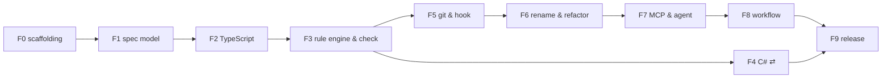

# CatSpec MVP: tasks

> Epic: **Reactive AST-Linked Spec Engine (CatSpec MVP v0.1)**.
> Breaks [`plan.md`](./plan.md) into **features → PBIs → tasks** to implement step by step.
> What to build is in [`spec.md`](./spec.md) (`§n`); decisions are in the
> [ADR log](../../architecture/adr/reactive-ast-adr.md); acceptance scenarios are spec §16 (`AC-n`).

## How to use this file

- **Order.** Work feature by feature. Inside a feature, take any PBI whose `depends on` PBIs are done.
  ⇄ marks work that can run in parallel with the critical path.
- **IDs.** Every feature and PBI has a stable kebab-case id. These become the machine spec ids
  (`<id>.spec.md` in this folder) once CatSpec can check itself. Features are *aggregate* specs
  over their PBIs (spec §17.1).
- **A PBI is done when** all of its tasks are ticked and it meets the plan's Definition of Done
  (plan §4): code + tests, diagnostics registered, CLI help and docs updated, CI green on 3 OSes.
  If behaviour differs from `spec.md`, update the spec in the same PR. Record architectural
  decisions in the ADR log (`AGENTS.md` Rule 2).
- **Bootstrapping.** Until PBI `dogfood-specs` (feature F3), CatSpec can't check itself yet, so tick
  the boxes by hand. After that, each new PBI gets its own `<id>.spec.md`, and agents follow the
  CatSpec workflow in `AGENTS.md` (`stage start` → `check --spec` → `stage finish`).

## Features overview

| # | Feature id | Plan | Weeks | Depends on | Exit criterion |
|---|---|---|---|---|---|
| F0 | `repo-scaffolding` | M0 | 0.5 | — | CI green on empty packages |
| F1 | `spec-model` | M1 | 1.5 | F0 | `check --specs-only` on fixtures; CST round-trip identity |
| F2 | `typescript-language-support` | M2 | 1.5 | F1 | golden facts for TS fixtures |
| F3 | `rule-engine-and-check` | M3 | 1.5 | F2 | AC-1, AC-6, AC-7 on TS; dogfood check in CI |
| F4 | `csharp-language-support` ⇄ | M4 | 1.5 | F3 | AC-1, AC-6 on C# |
| F5 | `git-integration-and-hook` | M5 | 1.5 | F3 | AC-4, AC-5; hook ≤ 1 s warm |
| F6 | `rename-and-refactor` | M6 | 1.5 | F5 | AC-2, AC-3, AC-11, AC-12 |
| F7 | `mcp-server-and-agent-layer` | M7 | 1 | F6 | AC-9, AC-10, AC-17; works in Claude Code |
| F8 | `workflow-profiles` | M8 | 1 | F7 | AC-14, AC-15, AC-16 |
| F9 | `release-0-1` | M9 | 1 | F4, F8 | all MVP AC (1–7, 9–12, 14–17), budgets, docs |

---

## F0 · `repo-scaffolding` (M0, 0.5 w)

Goal: an empty but complete monorepo with CI, ready for code.

### PBI `monorepo-setup`
- depends on: —
- [ ] npm workspaces: `packages/{core,lang,lang-typescript,lang-csharp,cli,mcp,catspec}`
- [ ] TypeScript 5 strict, ESM, shared `tsconfig`; `tsup` builds per package
- [ ] `vitest` with one placeholder test per package; `eslint` + `prettier`
- [ ] `changesets` for versioning; `npm run build|test|lint|typecheck` at the root
- Done: `npm test` passes locally.

### PBI `ci-pipeline`
- depends on: `monorepo-setup`
- [ ] GitHub Actions: lint, typecheck, test on Linux / macOS / Windows × Node 20 / 22
- [ ] cache npm; fail on warnings in lint
- Done: CI green on all 6 combinations.

### PBI `fixture-conventions`
- depends on: `monorepo-setup`
- [ ] `fixtures/<name>/{repo files, catspec.yaml, docs/spec/<feature>/, docs/architecture/adr/<name>-adr.md, expected.json}`
- [ ] test helper `loadFixture(name)` (copies into a temp dir)
- [ ] `CONTRIBUTING.md` (points to `AGENTS.md`, the ADR log and this file), issue templates
- Done: one sample fixture loads in a test.

---

## F1 · `spec-model` (M1, 1.5 w)

Goal: read, validate and edit `*.spec.md` files and build the dependency graph. No code parsing yet.
Spec: §3, §4, §5, §6 (parsing only), §8, §12 (CS01xx).

### PBI `diagnostics-core`
- depends on: `monorepo-setup`
- [ ] `Diagnostic` type (§12): code, severity, spec/code location, message, expected/actual, suggestions
- [ ] code registry (code → default severity, title, docs text); tests fail on unregistered codes
- [ ] reporters: `text`, `json`; exit codes 0/1/2/3 (§10)
- Done: reporter snapshot tests.

### PBI `config-loader`
- depends on: `diagnostics-core`
- [ ] zod schema for `catspec.yaml` (§4) incl. `layout`, `languages`, `enforcement`, `heal`, `hook`, `refactor`, `mcp`; `workflow` validated in F8
- [ ] defaults; discovery of the root `catspec.yaml` (walk up to the git root)
- [ ] JSON Schema export into `schemas/` for editor autocompletion
- Done: valid / invalid config fixtures produce the expected diagnostics.

### PBI `frontmatter-parser`
- depends on: `diagnostics-core`
- [ ] split the `---` block with exact byte offsets; body kept byte-for-byte
- [ ] parse with `yaml` `parseDocument` (CST + line/column positions)
- Done: positions are correct for nested keys, CRLF files and files without a body.

### PBI `spec-schema`
- depends on: `frontmatter-parser`
- [ ] zod for frontmatter (§5.2), bindings and members (§5.3), rules (§6.1–6.3, common fields `id`, `class`, `message`, `adr`, `paths`), waivers (§6.5)
- [ ] shorthand normalisation (`members: ["login"]`, `methods`-style string lists)
- [ ] map zod issue paths → YAML node ranges → `specLocation`
- [ ] CS0101 invalid schema, CS0102 unknown key (warning); detect aggregate specs (§17.1)
- Done: one fixture per field and per error; aggregate detection unit-tested.

### PBI `body-parser`
- depends on: `frontmatter-parser`
- [ ] remark → `[rule:id]` / `[binding:id]` references (CS0110 unknown id)
- [ ] bullets under `Contracts` / `Invariants` without a reference → CS0111
- [ ] `## Tasks` checklist → done / total
- Done: unit tests on Markdown samples.

### PBI `spec-loader`
- depends on: `config-loader`, `spec-schema`, `body-parser`
- [ ] discover specs via `specs.include`; build `SpecSet` (id → spec, file → specs)
- [ ] CS0103 duplicate id; CS0106 spec outside a feature folder (`layout: feature-folders`)
- [ ] architecture spec at `specs.architecture` (`docs/architecture/adr/*-adr.md`): CS0107 missing or ambiguous; CS0112 rule references an unknown ADR id
- Done: a fixture repo with 10 specs loads with the right diagnostics.

### PBI `dependency-graph`
- depends on: `spec-loader`
- [ ] build the DAG from `depends_on`; CS0104 unknown dependency; CS0105 cycle with the full path (Tarjan SCC)
- [ ] topological order; "ready" computed from statuses (§8)
- Done: cycle / unknown / self-dependency fixtures.

### PBI `spec-cst-editor`
- depends on: `frontmatter-parser`
- [ ] `applyPatch(spec, ops)` via `Document.setIn/deleteIn`; keeps comments, key order, quoting
- [ ] the body stays byte-for-byte identical
- [ ] golden round-trip suite and a fast-check property test (random edits on random valid docs)
- [ ] patch ops classified as **location** or **contract** (needed by F6 and F7, ADR-008)
- Done: no-op edit is identity on every fixture.

### PBI `cli-skeleton`
- depends on: `config-loader`, `dependency-graph`
- [ ] `commander` CLI: global flags `--cwd --config --format text|json --no-color --quiet --verbose`
- [ ] `catspec init`: `catspec.yaml`, `docs/spec/<example-feature>/` (spec.md, plan.md, one `*.spec.md`), `docs/architecture/adr/<name>-adr.md` (`--name` or the repo folder name)
- [ ] `catspec check --specs-only`, `list [--status] [--ready]`, `show <spec>`, `graph --format mermaid|dot|json`
- Done: `init` in an empty repo, then `check --specs-only` → exit 0; F1 exit criterion met.

---

## F2 · `typescript-language-support` (M2, 1.5 w)

Goal: turn TypeScript files into normalised `FileFacts`. Spec: §11.2, §11.7, ADR-002, ADR-003.

### PBI `adapter-interface`
- depends on: `cli-skeleton`
- [ ] `LanguageAdapter`, `FileFacts`, `SymbolFact`, `ImportFact`, `CallFact` types **in `core`** (ADR-003)
- [ ] adapter registry in `lang`; language chosen by extension + `languages.*.include/exclude`
- Done: `core` builds without any Tree-sitter dependency.

### PBI `tree-sitter-runtime`
- depends on: `adapter-interface`
- [ ] `web-tree-sitter` initialised once; grammar `.wasm` loaded from the adapter package
- [ ] `scripts/build-grammars`: build pinned grammar releases to WASM (interim: prebuilt `tree-sitter-wasms`, pinned)
- [ ] query runner: compile `.scm` once per language; typed capture iteration
- Done: a smoke test parses a TS file on all 3 OSes.

### PBI `type-normaliser`
- depends on: `adapter-interface`
- [ ] parse type text like `A.B<C.D, E>` into a tree; segment-wise suffix matching
- [ ] qualified-name suffix matching for symbols
- Done: table-driven unit tests.

### PBI `typescript-adapter`
- depends on: `tree-sitter-runtime`, `type-normaliser`
- [ ] declarations: class, interface, type alias, enum, function, exported const arrow functions, methods, properties, constructor params (incl. parameter properties), getters/setters, overloads
- [ ] modifiers, decorators (name + args), `export` / `export default`, `implements` / `extends`, generics
- [ ] imports (static, `import type`, literal `import()`, literal `require`); re-exports recorded, not resolved
- [ ] calls (callee text + enclosing symbol); qualified names `path#Outer.Inner`
- [ ] type normalisation (`Array<T>` ≡ `T[]`, whitespace, `readonly` params)
- [ ] files with parse errors → partial facts + CS0901, never a crash
- [ ] hidden debug command `catspec show-facts <file>`
- Done: golden `FileFacts` for ~25 TS fixtures.

### PBI `parse-cache-and-index`
- depends on: `typescript-adapter`
- [ ] cache `FileFacts` by git blob SHA in `<git-common-dir>/catspec/cache/<lang>/`, keyed by adapter + grammar version; in-memory fallback outside git
- [ ] lazy repo-wide symbol index (name → symbol ids)
- Done: a cache hit skips parsing (measured in a test).

---

## F3 · `rule-engine-and-check` (M3, 1.5 w)

Goal: the first end-to-end slice. Specs are checked against TypeScript code.
Spec: §6, §8, §10 (`check`, `coverage`, `status`), §11.3, §11.5, §12.

### PBI `binding-resolver`
- depends on: `parse-cache-and-index`, `spec-loader`
- [ ] resolution order: `file` hint → lock-file path (from F5) → repo-wide index (§11.5)
- [ ] CS0201 not found with did-you-mean (Damerau-Levenshtein, same kind, same file first); CS0202 ambiguous
- Done: unit tests on synthetic facts.

### PBI `contract-evaluator`
- depends on: `binding-resolver`
- [ ] kind, exported / visibility, `implements` / `extends` (normalised suffix), attributes / decorators
- [ ] members: existence, kind, positional params with `*`, returns, modifiers, `optional`
- [ ] `constructor.requires`; CS0220 when syntax can't decide
- [ ] every check emits its own item id (`binding:auth.login`) for the ratchet (F5)
- Done: CS0203–CS0208 covered by synthetic-fact tests.

### PBI `structural-rules`
- depends on: `contract-evaluator`
- [ ] `forbid_call`, `require_call`, `forbid_import`, `allow_import_only`, `naming`, `must_not_exist`
- [ ] `within` (binding / member ranges) and `paths` scoping
- Done: CS0601–CS0605 tests.

### PBI `query-and-test-rules`
- depends on: `contract-evaluator`
- [ ] `query` rules: compiled at spec load (CS0130 invalid), `expect: absent|present` (CS0610)
- [ ] `test` rules: test symbol must exist (CS0620); `--run-tests` runs `tests.command` via `execFile` (CS0621)
- Done: fixtures for each.

### PBI `architecture-rules`
- depends on: `structural-rules`
- [ ] rules from the architecture spec apply repo-wide (§6.4); `draft` architecture spec = not enforced
- Done: AC-6 (Domain importing Infrastructure → CS0603) on a TS fixture.

### PBI `status-and-waivers`
- depends on: `contract-evaluator`, `dependency-graph`
- [ ] enforcement matrix by status (§8) (the ratchet arrives in F5)
- [ ] waivers with reason and `until` (CS0400 waived, CS0401 expired)
- [ ] `catspec status <spec> <status> [--force]`: `implemented` only if `check --spec` passes; `in-progress` only if dependencies are implemented (CS0502)
- Done: AC-7.

### PBI `check-command`
- depends on: `structural-rules`, `query-and-test-rules`, `status-and-waivers`
- [ ] `catspec check [paths] [--spec <id>…] [--specs-only]` over the working tree (§11.3 pipeline)
- [ ] `--spec`: agent-friendly report (expected / found / fix per item, ends with DONE / NOT DONE, exit 0 = done)
- [ ] `catspec coverage`: contract satisfaction, enforcement coverage, reverse coverage (F-3); `manual` rules and CS0111 counted
- [ ] diagnostic message snapshot tests (wording is UX)
- Done: AC-1 on a TS fixture.

### PBI `dogfood-specs`
- depends on: `check-command`, `architecture-rules`
- [ ] `catspec.yaml` for this repo; set the ADR log's frontmatter (`docs/architecture/adr/reactive-ast-adr.md`) from `draft` to enforced
- [ ] first machine specs in this folder, e.g. `core-public-api.spec.md` binding `LanguageAdapter` and `FileFacts`
- [ ] `catspec check` runs in this repo's CI
- Done: CI fails if `core` imports Tree-sitter (ADR-003 rule). **From here on, PBIs get `<id>.spec.md` files.**

---

## F4 · `csharp-language-support` ⇄ (M4, 1.5 w, parallel with F5–F6)

Goal: the same `FileFacts` for C#. Spec: §5.3, plan M4.

### PBI `csharp-declarations`
- depends on: `check-command`
- [ ] pinned `tree-sitter-c-sharp` → WASM
- [ ] namespaces (block + file-scoped), class / struct / record / interface / enum, nested types
- [ ] methods, properties, fields, events, constructors incl. primary constructors (C# 12)
- Done: golden facts for declaration fixtures.

### PBI `csharp-attributes-bases-imports`
- depends on: `csharp-declarations`
- [ ] modifiers incl. `partial`, `async`, `override`; attributes with argument text
- [ ] base list → `bases`; documented `extends` heuristic (§F-5)
- [ ] `using` / `global using` as imports; alias map used to normalise base names in the same file
- [ ] calls: invocation and member-access text
- Done: golden facts for controllers, handlers and records.

### PBI `csharp-partials-and-types`
- depends on: `csharp-attributes-bases-imports`
- [ ] merge `partial` declarations across the binding's file set
- [ ] type normalisation: `global::`, nullable `T?`, optional `System.` prefix, generic arity, tuples, arrays
- Done: partial-class fixtures.

### PBI `csharp-acceptance`
- depends on: `csharp-partials-and-types`
- [ ] fixture "microservice" with the requirements' `UserUpdatedHandler` example spec
- Done: AC-1 and AC-6 on C#; the example passes and fails exactly as expected.

---

## F5 · `git-integration-and-hook` (M5, 1.5 w)

Goal: the pre-commit gate, checking exactly what is committed. Spec: §7, §8, §13, ADR-004, ADR-006, ADR-009.

### PBI `git-access`
- depends on: `check-command`
- [ ] `execFile` wrapper, never a shell (ADR-009); long-lived `git cat-file --batch`
- [ ] `ls-files -s -z`, `diff --cached -M --name-status -z`, `rev-parse --git-common-dir --show-toplevel`
- [ ] CS0902 when git is missing; temp-repo test helper `withRepo(fn)`
- Done: integration tests on 3 OSes.

### PBI `source-providers`
- depends on: `git-access`
- [ ] `WorkingTreeProvider`, `IndexProvider` (specs and sources read from the index), `RevisionProvider` (for F6)
- Done: the same check gives the same result whichever provider supplies the content.

### PBI `staged-check`
- depends on: `source-providers`
- [ ] `check --staged`: scope = changed files ∪ files of changed specs ∪ bound files from the lock files
- Done: AC-5 (partial staging, both directions).

### PBI `lock-files`
- depends on: `source-providers`
- [ ] `<spec-id>.lock.json` next to each spec (§7): deterministic writer, per-item spec hash
- [ ] `catspec baseline --rebuild`; CS0108 lock file without a spec
- Done: byte-identical output on repeated runs.

### PBI `ratchet`
- depends on: `lock-files`
- [ ] passing items added to `satisfied`; regression → CS0301 even when `in-progress`
- [ ] items invalidated when their part of the spec changes
- Done: AC-4.

### PBI `drift-and-accept`
- depends on: `lock-files`
- [ ] shape fingerprints (bodies excluded); CS0300 for `implemented` specs per `enforcement.drift`
- [ ] `catspec accept <spec>`
- Done: drift fixtures (signature change → drift; body change → none).

### PBI `hook-installer`
- depends on: `staged-check`, `ratchet`
- [ ] `install-hooks` / `uninstall-hooks`: plain git, `core.hooksPath`, husky, lefthook; chain and back up foreign hooks
- [ ] the hook updates and re-stages lock files of touched specs (`hook.stage_generated`); `CATSPEC_SKIP=1`
- [ ] `init --hooks`
- Done: hook ≤ 1 s warm on the fixture repo; chaining tests.

---

## F6 · `rename-and-refactor` (M6, 1.5 w)

Goal: renames and moves never leave specs stale. Spec: §11.4, §11.6, §11.8, ADR-008, ADR-013, ADR-016.

### PBI `rename-detection`
- depends on: `hook-installer`
- [ ] moved → file renamed (`git diff -M`) → symbol renamed with score (§11.4)
- [ ] body-token similarity (Jaccard over token 3-grams, computed on demand)
- Done: fixtures for class / method rename, rename + move, ambiguous, below threshold.

### PBI `sync-command`
- depends on: `rename-detection`, `spec-cst-editor`
- [ ] location-only `SpecPatch` (contract edits never automatic); CS0210 with the patch
- [ ] `catspec sync` (dry-run diff) / `sync --apply`; `heal.mode=auto` applies and re-stages in the hook
- [ ] body mentions of old names → info; rewritten only with `--update-mentions`
- Done: AC-2, AC-3; a test asserts no auto patch touches contract fields.

### PBI `bind-command`
- depends on: `spec-cst-editor`, `binding-resolver`
- [ ] `catspec bind <symbol> --spec <id> [--file f]`: binding scaffolded from the current shape
- Done: round-trip test (bind → check passes).

### PBI `batch-rename-mapping`
- depends on: `sync-command`
- [ ] baseline capture (refactor baseline, or `HEAD`); name-free fingerprints
- [ ] rename map `--map` (`symbols` / `namespaces` / `paths`); prefix-rule detection
- [ ] global one-to-one assignment; report mapped / ambiguous (CS0216) / lost (CS0217)
- [ ] lock entries moved to new ids (ratchet survives); name-only shape changes auto-accepted
- Done: AC-11 (40-class namespace rename + folder move), AC-12 (ambiguous without a map).

### PBI `refactor-mode`
- depends on: `batch-rename-mapping`
- [ ] `catspec refactor [--scope] [--reason] [--allow-wip]`, `refactor status`, `refactor abort`; baseline in the runtime store
- [ ] during a refactor, `sync --apply` ends it on success; `--partial` keeps it open
- [ ] hook: one grouped CS0215 above `refactor.detect_threshold`; `--allow-wip` only on the recorded branch
- Done: a multi-commit refactor fixture ends cleanly.

---

## F7 · `mcp-server-and-agent-layer` (M7, 1 w)

Goal: agents use CatSpec by themselves, and "done" is decided by CatSpec. Spec: §14, ADR-008.

### PBI `mcp-server-core`
- depends on: `refactor-mode`
- [ ] `@catspec/mcp` on `@modelcontextprotocol/sdk` (stdio); `catspec mcp`
- [ ] warm engine between calls; config / spec reload on change; repo-root path guard
- Done: an in-process MCP client test harness.

### PBI `mcp-tools`
- depends on: `mcp-server-core`
- [ ] `list_specs`, `get_spec_context`, `check_compliance`, `find_specs_for_file`, `check_dependencies`
- [ ] `update_spec_bindings` (`dry_run` default; contract edits only proposed unless `mcp.allow_contract_edits`)
- [ ] `set_spec_status` (refuses `implemented` while contracts fail); `start_refactor`, `sync_specs`
- [ ] text + `structuredContent` outputs; diagnostics are results, not protocol errors
- Done: AC-9 (scripted agent loop), AC-10 (agent can't weaken a contract).

### PBI `mcp-resources-and-prompts`
- depends on: `mcp-tools`
- [ ] resources `catspec://spec/{id}`, `catspec://architecture`, `catspec://graph`, `catspec://diagnostics`
- [ ] prompts `implement-spec`, `fix-drift`
- Done: resource and prompt listing tests.

### PBI `agent-check-mode`
- depends on: `check-command`
- [ ] `check --in-progress` (specs `in-progress` on the current branch; exit 0 when none)
- [ ] `--format agent`: short fix list; exit 0 done / 2 not done / 1 error
- [ ] loop protection: read the hook input from stdin, `--max-blocks` (default 3) with the same diagnostics, counter in the runtime store
- Done: unit tests for each exit path.

### PBI `agent-setup`
- depends on: `agent-check-mode`, `mcp-tools`
- [ ] `init --agents`: `AGENTS.md` block between `catspec:begin/end` markers (created or updated, rest untouched)
- [ ] merge the Claude Code `Stop` hook into `.claude/settings.json` without losing existing hooks
- [ ] docs: MCP setup for Claude Code (`claude mcp add catspec -- npx catspec mcp`), Claude Desktop, Cursor, Windsurf
- Done: AC-17 (agent can't stop early; let go after 3 identical failures).

### PBI `claude-code-validation`
- depends on: `agent-setup`, `mcp-resources-and-prompts`
- [ ] run the `AuthService` user journey with Claude Code on the TS fixture
- [ ] save the transcript in `examples/` of this folder
- Done: the journey completes without a human typing `catspec` commands.

---

## F8 · `workflow-profiles` (M8, 1 w)

Goal: CatSpec gates the team's own SDD workflow. Spec: §17, ADR-015, ADR-016.

### PBI `workflow-config`
- depends on: `claude-code-validation`
- [ ] `workflow:` schema (§17.2): presets, stages, `per: feature|spec`, drivers (`skill`, `slash`, `command`, `manual`), `produces`, `start` / `finish` gates and statuses, placeholders `{feature}`, `{feature_dir}`, `{spec}`
- [ ] CS0700 invalid config; JSON Schema export
- Done: config fixtures.

### PBI `stage-resolution`
- depends on: `workflow-config`
- [ ] derive the current stage per feature and per work item (no stored state, ADR-004)
- [ ] feature targets for `per: spec` stages (run for every spec of the feature)
- Done: unit tests over status / artifact combinations.

### PBI `gate-runner`
- depends on: `stage-resolution`
- [ ] gates `specs_valid`, `artifacts`, `contracts_declared`, `deps_known`, `deps_ready`, `contracts_pass`, `tasks_done`, `no_drift`, `adr_valid`
- [ ] `command:` gates only with `workflow.allow_commands`, via `execFile` (CS0706 when skipped)
- [ ] CS0701 / CS0702 / CS0705
- Done: one test per gate.

### PBI `workflow-cli`
- depends on: `gate-runner`
- [ ] `catspec next <feature>`; `catspec stage start|finish <stage> <feature|spec-id> [--force]`
- [ ] `catspec workflow show [feature]`, `workflow doctor` (CS0704), `workflow snippet <stage|agents>`
- Done: AC-14 (custom `sdd-*` skills), AC-16 (doctor).

### PBI `workflow-mcp`
- depends on: `workflow-cli`
- [ ] MCP `next_step`, `start_stage`, `finish_stage`; `workflow` block in `get_spec_context`; generated `stage-<id>` prompts
- Done: MCP harness tests.

### PBI `workflow-presets`
- depends on: `workflow-cli`
- [ ] presets `catspec` and `custom`
- [ ] presets `openspec` and `spec-kit`: first verify their current layouts and command names, then pin per preset version; fixture repos for both
- [ ] detection in `catspec init` (`openspec/`, `.specify/`, `sdd-*` skills)
- Done: AC-15; `workflow doctor` clean on all fixture repos.

### PBI `workflow-hook`
- depends on: `gate-runner`, `hook-installer`
- [ ] `workflow.enforce_in_hook`: CS0703 for `implemented` specs, built-in gates only (never `command:`)
- Done: hook budget unchanged (benchmark).

---

## F9 · `release-0-1` (M9, 1 w)

Goal: a 0.1.0 people can install and trust. Spec: §15, §16.

### PBI `performance-budgets`
- depends on: `workflow-hook`, `csharp-acceptance`
- [ ] synthetic 10k-file repo generator (TS + C#)
- [ ] benchmark job: staged ≤ 1 s warm, full ≤ 10 s cold; profile and fix hot spots
- Done: the budgets are asserted in CI.

### PBI `robustness-fuzzing`
- depends on: `csharp-acceptance`
- [ ] fuzz both adapters with random / truncated files (no throws); skip huge files with CS0901
- Done: fuzz job green.

### PBI `user-guide`
- depends on: `workflow-presets`
- [ ] user docs in feature folder `docs/spec/catspec-user-guide/` (per `AGENTS.md`): quick start, spec format, rule catalogue, diagnostics reference (generated from the code registry), agent integration, workflow presets, FAQ on syntactic limits
- [ ] update `README.md` from "design stage" to the released state
- Done: docs reviewed against the CLI `--help` output.

### PBI `example-repos`
- depends on: `workflow-presets`
- [ ] `examples/ts-auth-service` (the `AuthService` journey) and `examples/dotnet-user-sync` (`UserUpdatedHandler`)
- Done: both examples run in CI.

### PBI `release-packaging`
- depends on: `performance-budgets`, `robustness-fuzzing`, `user-guide`, `example-repos`
- [ ] `catspec` meta-package (CLI + MCP + adapters); `npx catspec init` smoke test on clean machines (3 OSes)
- [ ] final acceptance sweep: AC-1–7, 9–12, 14–17 in CI
- [ ] publish 0.1.0 with changesets; release notes with the known limits
- Done: **epic complete**: every feature above is closed.

---

## Not in this epic (post-MVP, see plan §2)

CI gate and SARIF (0.2) · Python / Go adapters (0.3) · claims and agent locks, AC-8 and AC-13
(0.4, ADR-014) · graph UI and IDE extension (0.5) · LLM-judged invariants (later).
