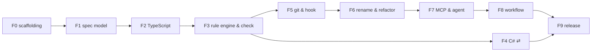

# CatSpec MVP: tasks

> Epic: **Reactive AST-Linked Spec Engine (CatSpec MVP v0.1)**.
> Breaks [`plan.md`](./plan.md) into **features → PBIs → tasks** to implement step by step.
> What to build is in [`spec.md`](./spec.md) (`§n`), requirements and findings are in
> [`analysis.md`](./analysis.md) (`C-n`, `F-n`), decisions are in the
> [ADR log](../../architecture/adr/reactive-ast-adr.md) (`ADR-n`), and the epic's acceptance
> scenarios are spec §16 (`spec AC-n`).

## How to use this file

- **Order.** Work feature by feature. Inside a feature, take any PBI whose `depends on` PBIs are done.
  ⇄ marks work that can run in parallel with the critical path.
- **IDs.** Every feature and PBI has a stable kebab-case id. These become the machine spec ids
  (`<id>.spec.md` in this folder) once CatSpec can check itself. Features are *aggregate* specs
  over their PBIs (spec §17.1).
- **Ask before deviating.** If the work needs behaviour, scope or order that differs from
  `spec.md`, `plan.md` or this file, **ask first**: state the difference, give 2–3 proposals with
  a recommendation, and wait for the owner's approval before changing any of these files
  (`AGENTS.md` Rules 1.5 and 3). Architectural decisions go into the ADR log only after the same
  approval (`AGENTS.md` Rule 2).
- **Approvals.** No merge into `main` and no change to any `.md` file (including ticking
  boxes here) without the owner's explicit approval (`AGENTS.md` Rule 3).
- **Bootstrapping.** Until PBI `dogfood-specs` (feature F3), CatSpec can't check itself yet, so the
  acceptance-coverage check (below) is the only gate. After that, each new PBI also gets its own
  `<id>.spec.md`, and CatSpec gates the work as well (`stage start` → `check --spec` → `stage finish`).

## Acceptance criteria (Gherkin)

- Every feature and every PBI has acceptance criteria written in **Gherkin**
  (`Scenario` / `Given` / `When` / `Then`, plus `And`).
  - **Feature scenarios** are end-to-end: they describe what a user sees.
  - **PBI scenarios** are narrower (unit or integration level).
- Every scenario has a unique tag:
  - `@AC-F<n>-<k>` for a feature scenario;
  - `@AC-<pbi-id>-<k>` for a PBI scenario.

  A scenario that implements one of the epic's scenarios also names it, e.g. `(spec AC-1)`.
- **Every scenario becomes an automated test** whose name starts with its tag in brackets, e.g.
  `it("[AC-check-command-1] reports a missing member with did-you-mean", …)`. Scenario text and test
  name must describe the same behaviour.

## Definition of Done

### PBI checklist (applies to every PBI, in addition to its own tasks)

- [ ] every task of the PBI is done;
- [ ] every acceptance scenario of the PBI has a test tagged with its id, and **all tests pass**
      locally and in CI on Linux, macOS and Windows;
- [ ] **requirements check:** the implementation was compared with every spec section the PBI
      cites. It does what they say, nothing is missing, and nothing was added beyond them.
      Any difference was raised with the owner and approved (Rule 3) before merging;
- [ ] no new lint or type errors; new diagnostics are in the code registry with docs text;
      CLI help and docs are updated;
- [ ] the owner approved ticking the PBI's boxes in this file (Rule 3).

### Feature checklist (repeated in each feature below)

- [ ] all PBIs of the feature meet the PBI checklist;
- [ ] every feature scenario is an automated end-to-end test, passing in CI on 3 OSes;
- [ ] requirements review: every item under "Requirements covered" was checked against the
      implementation, and differences were approved by the owner;
- [ ] (from F3 on) `catspec stage finish close <feature>` passes;
- [ ] the owner approved closing the feature.

### How the Definition of Done is enforced

| Gate | From | What it blocks |
|---|---|---|
| **Acceptance-coverage check** in CI (PBI `ci-pipeline`) | F0 | A PBI whose boxes are all ticked, or a closed feature, that has a scenario with no test, or whose tagged test fails, fails CI. A test with a tag that isn't in this file also fails CI. |
| **PR template** with the PBI checklist (PBI `ci-pipeline`, created after owner approval) | F0 | Every PR states which PBIs it covers and ticks the checklist for review. |
| **Branch protection on `main`** (owner action) | F0 | PRs can't be merged while CI is red, and need the owner's approval. |
| **CatSpec checking itself** (PBI `dogfood-specs`) | F3 | `catspec check` in CI; `stage finish close` refuses while contracts fail or tasks are unticked. |

## Features overview

| # | Feature id | Plan | Weeks | Depends on | Acceptance |
|---|---|---|---|---|---|
| F0 | `repo-scaffolding` | M0 | 0.5 | — | `@AC-F0-1..2` |
| F1 | `spec-model` | M1 | 1.5 | F0 | `@AC-F1-1..4` |
| F2 | `typescript-language-support` | M2 | 1.5 | F1 | `@AC-F2-1..3` |
| F3 | `rule-engine-and-check` | M3 | 1.5 | F2 | `@AC-F3-1..5` (spec AC-1, AC-6, AC-7) |
| F4 | `csharp-language-support` ⇄ | M4 | 1.5 | F3 | `@AC-F4-1..3` (spec AC-1, AC-6 on C#) |
| F5 | `git-integration-and-hook` | M5 | 1.5 | F3 | `@AC-F5-1..4` (spec AC-4, AC-5) |
| F6 | `rename-and-refactor` | M6 | 1.5 | F5 | `@AC-F6-1..4` (spec AC-2, AC-3, AC-11, AC-12) |
| F7 | `mcp-server-and-agent-layer` | M7 | 1 | F6 | `@AC-F7-1..4` (spec AC-9, AC-10, AC-17) |
| F8 | `workflow-profiles` | M8 | 1 | F7 | `@AC-F8-1..3` (spec AC-14, AC-15, AC-16) |
| F9 | `release-0-1` | M9 | 1 | F4, F8 | `@AC-F9-1..3` (all MVP spec AC) |



---

## F0 · `repo-scaffolding` (M0, 0.5 w)

**Description.** Before any feature can be built, the project needs a home: a monorepo with all
packages, a build, tests, and CI that runs on every operating system we support. This feature
also sets up the gates that keep the Definition of Done honest from the very first PR: the
acceptance-coverage check and the PR template.

**Requirements covered.** spec §11.1 (packages), §15 (platforms, quality) · ADR-001 · plan M0.

**Acceptance criteria**

```gherkin
Feature: F0 repo-scaffolding

  @AC-F0-1
  Scenario: A fresh clone builds and tests on every supported platform
    Given a fresh clone of the repository on Linux, macOS or Windows with Node 20 or 22
    When I run "npm ci" and then "npm test"
    Then every package builds
    And every test passes

  @AC-F0-2
  Scenario: Ticking a PBI without tests is rejected
    Given a PBI whose boxes are all ticked in tasks.md
    And one of its scenario tags has no test
    When CI runs on the pull request
    Then the acceptance-coverage check fails and names the missing tag
```

**Definition of Done (feature)**
- [ ] all PBIs meet the PBI checklist
- [ ] `@AC-F0-1..2` are automated and pass in CI on 3 OSes
- [ ] requirements review done; differences approved by the owner
- [ ] owner approved closing the feature

### PBI `monorepo-setup`
Creates the npm-workspaces monorepo with every package and the shared build, test and lint tooling.
- depends on: —
- [ ] npm workspaces: `packages/{core,lang,lang-typescript,lang-csharp,cli,mcp,catspec}`
- [ ] TypeScript 5 strict, ESM, shared `tsconfig`; `tsup` builds per package
- [ ] `vitest` with one placeholder test per package; `eslint` + `prettier`
- [ ] `changesets` for versioning; `npm run build|test|lint|typecheck` at the root

```gherkin
  @AC-monorepo-setup-1
  Scenario: Root scripts work across all packages
    Given the monorepo with seven packages
    When I run "npm run build", "npm run lint", "npm run typecheck" and "npm test" at the root
    Then each command succeeds and covers every package
```

### PBI `ci-pipeline`
Runs every check on every pull request and enforces the Definition of Done automatically.
- depends on: `monorepo-setup`
- [ ] GitHub Actions: lint, typecheck, test on Linux / macOS / Windows × Node 20 / 22; npm cache; lint warnings fail
- [ ] **acceptance-coverage script** (`scripts/check-acceptance.ts`): parses the `@AC-…` tags in this file, finds which PBIs are fully ticked and which features are closed, and matches tags to test names (`[AC-…]`) and results
- [ ] the script runs as a required CI step
- [ ] PR template `.github/pull_request_template.md` with the PBI checklist (propose the text to the owner first; Rule 3)
- [ ] ask the owner to enable branch protection on `main`: required CI, owner approval

```gherkin
  @AC-ci-pipeline-1
  Scenario: CI runs the full matrix
    Given a pull request
    When CI runs
    Then lint, typecheck and tests run on 3 operating systems with Node 20 and Node 22

  @AC-ci-pipeline-2
  Scenario: A ticked PBI with a failing tagged test fails CI
    Given a PBI whose boxes are all ticked
    And the test tagged "[AC-<pbi-id>-1]" fails
    When the acceptance-coverage check runs
    Then it fails and names the PBI and the failing scenario

  @AC-ci-pipeline-3
  Scenario: Unticked PBIs don't need tests yet
    Given a PBI with unticked boxes and no tests
    When the acceptance-coverage check runs
    Then it passes for that PBI

  @AC-ci-pipeline-4
  Scenario: A test tag that is not in tasks.md fails CI
    Given a test named "[AC-unknown-1] …"
    When the acceptance-coverage check runs
    Then it fails with "unknown acceptance tag AC-unknown-1"
```

### PBI `fixture-conventions`
Defines how test fixtures (small sample repositories) are laid out and loaded, so all later features test the same way.
- depends on: `monorepo-setup`
- [ ] `fixtures/<name>/{repo files, catspec.yaml, docs/spec/<feature>/, docs/architecture/adr/<name>-adr.md, expected.json}`
- [ ] test helper `loadFixture(name)` that copies a fixture into a temporary directory
- [ ] `CONTRIBUTING.md` pointing to `AGENTS.md`, the ADR log and this file (propose the text first; Rule 3)

```gherkin
  @AC-fixture-conventions-1
  Scenario: A fixture is isolated per test
    Given the fixture "sample"
    When two tests load it and one of them modifies files
    Then the other test still sees the original fixture
```

---

## F1 · `spec-model` (M1, 1.5 w)

**Description.** CatSpec has to understand spec files before it can check any code. This feature
reads `*.spec.md` files and the config, validates them with clear error messages that point to the
exact line, builds the dependency graph between specs, and can edit spec files without destroying
their formatting. At the end you can run `catspec init` and `catspec check --specs-only` in a real
repository.

**Requirements covered.** analysis C1, C5, C9; F-1, F-2, F-11, F-12, F-15, F-17 · spec §3, §4, §5,
§6 (parsing), §8 (statuses), §12 (CS01xx) · ADR-004, ADR-008, ADR-011, ADR-012, ADR-017.

**Acceptance criteria**

```gherkin
Feature: F1 spec-model

  @AC-F1-1
  Scenario: init creates a working layout
    Given an empty git repository
    When I run "catspec init"
    Then catspec.yaml, docs/spec/<example-feature>/ and docs/architecture/adr/<name>-adr.md exist
    And "catspec check --specs-only" exits 0

  @AC-F1-2
  Scenario: Spec errors point to the exact line
    Given a spec whose binding has "kind: klass" on line 9
    When I run "catspec check --specs-only"
    Then it exits 1
    And it reports CS0101 at the spec file, line 9, listing the allowed kinds

  @AC-F1-3
  Scenario: Dependency cycles are reported with the full path
    Given specs a → b → c → a via depends_on
    When I run "catspec check --specs-only"
    Then it reports CS0105 with the cycle "a → b → c → a"

  @AC-F1-4
  Scenario: The dependency graph can be exported
    Given specs with depends_on relations
    When I run "catspec graph --format mermaid"
    Then the output is a valid mermaid graph with one node per spec and one edge per dependency
```

**Definition of Done (feature)**
- [ ] all PBIs meet the PBI checklist
- [ ] `@AC-F1-1..4` are automated and pass in CI on 3 OSes
- [ ] requirements review done; differences approved by the owner
- [ ] owner approved closing the feature

### PBI `diagnostics-core`
Defines what an error or warning looks like everywhere in CatSpec (code, severity, location, message) and how it is printed.
- depends on: `monorepo-setup`
- spec: §12, §10 (exit codes)
- [ ] `Diagnostic` type: code, severity, spec / code location, message, expected / actual, suggestions
- [ ] code registry (code → default severity, title, docs text)
- [ ] reporters `text` and `json`; exit codes 0 / 1 / 2 / 3

```gherkin
  @AC-diagnostics-core-1
  Scenario: Exit code reflects the worst severity
    Given diagnostics with only warnings
    When they are reported
    Then the exit code is 0
    But with at least one error the exit code is 1

  @AC-diagnostics-core-2
  Scenario: Unregistered codes are rejected
    Given code that emits diagnostic "CS9999", which is not in the registry
    When the tests run
    Then a test fails naming "CS9999"

  @AC-diagnostics-core-3
  Scenario: JSON output is machine-readable
    Given two diagnostics
    When reported with "--format json"
    Then the output is valid JSON with code, severity, locations and message for both
```

### PBI `config-loader`
Reads and validates `catspec.yaml` so every command uses the same settings, and a mistake in the config is reported clearly.
- depends on: `diagnostics-core`
- spec: §4
- [ ] zod schema for `catspec.yaml` incl. `layout`, `languages`, `enforcement`, `heal`, `hook`, `refactor`, `mcp` (`workflow` is validated in F8)
- [ ] defaults; discovery of the root `catspec.yaml` (walk up to the git root)
- [ ] JSON Schema export into `schemas/` for editor autocompletion

```gherkin
  @AC-config-loader-1
  Scenario: Missing config uses the defaults
    Given a repository without catspec.yaml
    When the config is loaded
    Then every value equals the default in spec §4

  @AC-config-loader-2
  Scenario: Invalid value is reported with key, line and allowed values
    Given catspec.yaml containing "heal.mode: sometimes" on line 12
    When the config is loaded
    Then an error names "heal.mode", line 12 and the allowed values "off, suggest, auto"

  @AC-config-loader-3
  Scenario: Config is found from a subfolder
    Given catspec.yaml at the repository root
    When a command runs from "src/services"
    Then the root catspec.yaml is used
```

### PBI `frontmatter-parser`
Splits a spec file into its YAML header and Markdown body and remembers exact positions for error messages.
- depends on: `diagnostics-core`
- spec: §5
- [ ] split the `---` block with exact byte offsets; body kept byte-for-byte
- [ ] parse with `yaml` `parseDocument` (CST + line / column positions)

```gherkin
  @AC-frontmatter-parser-1
  Scenario Outline: Positions are correct
    Given a spec file with <shape>
    When it is parsed
    Then the line and column of every frontmatter key are correct
    Examples:
      | shape                    |
      | nested keys              |
      | Windows line endings     |
      | no Markdown body         |

  @AC-frontmatter-parser-2
  Scenario: A file without frontmatter is an error, not a crash
    Given a ".spec.md" file without a "---" header
    When it is parsed
    Then CS0101 is reported for line 1
```

### PBI `spec-schema`
Validates the meaning of the spec header (bindings, members, rules, waivers) and turns shorthand forms into the full model.
- depends on: `frontmatter-parser`
- spec: §5.2, §5.3, §6.1–6.3, §6.5, §17.1 (aggregate specs)
- [ ] zod for frontmatter, bindings and members, rules (common fields `id`, `class`, `message`, `adr`, `paths`), waivers
- [ ] shorthand normalisation (`members: ["login"]`)
- [ ] map validation issue paths → YAML node ranges → `specLocation`
- [ ] CS0101 invalid schema, CS0102 unknown key (warning); aggregate spec detection

```gherkin
  @AC-spec-schema-1
  Scenario: Shorthand members expand to full members
    Given a binding with "members: [login, logout]"
    When the spec is validated
    Then the model has two members named "login" and "logout" of any kind, not optional

  @AC-spec-schema-2
  Scenario: Unknown keys only warn
    Given a spec with the top-level key "jira: ABC-1"
    When the spec is validated
    Then CS0102 is reported as a warning and the spec is still loaded

  @AC-spec-schema-3
  Scenario: Aggregate specs are recognised
    Given a spec with depends_on but no bindings and no rules
    When the spec is validated
    Then it is marked as an aggregate spec
```

### PBI `body-parser`
Reads the human part of a spec: references to rules, unenforced invariants and the task checklist.
- depends on: `frontmatter-parser`
- spec: §5.4
- [ ] remark → `[rule:id]` / `[binding:id]` references (CS0110 for unknown ids)
- [ ] bullets under `Contracts` / `Invariants` without a reference → CS0111
- [ ] `## Tasks` checklist → done / total

```gherkin
  @AC-body-parser-1
  Scenario: Unknown reference is an error
    Given a body bullet "[rule:no-consol] No console logging" and no rule "no-consol"
    When the spec is loaded
    Then CS0110 is reported at that line

  @AC-body-parser-2
  Scenario: Prose invariant without a rule is reported
    Given a bullet under "## Contracts" without any [rule:] or [binding:] reference
    When the spec is loaded
    Then CS0111 "unenforced prose invariant" is reported

  @AC-body-parser-3
  Scenario: Task progress is counted
    Given "## Tasks" with 3 items, 2 of them ticked
    When the spec is loaded
    Then progress is 2 of 3
```

### PBI `spec-loader`
Finds all specs in the repository, indexes them and checks repo-level rules (unique ids, folder layout, ADR log location).
- depends on: `config-loader`, `spec-schema`, `body-parser`
- spec: §3, §4, §6.4, §12
- [ ] discover specs via `specs.include`; build `SpecSet` (id → spec, file → specs)
- [ ] CS0103 duplicate id; CS0106 spec outside a feature folder (`layout: feature-folders`)
- [ ] architecture spec at `specs.architecture`: CS0107 missing or ambiguous; CS0112 rule referencing an unknown ADR id

```gherkin
  @AC-spec-loader-1
  Scenario: Duplicate ids are reported in both files
    Given two spec files with "id: login"
    When specs are loaded
    Then CS0103 is reported with both file paths

  @AC-spec-loader-2
  Scenario: Spec outside a feature folder
    Given "docs/login.spec.md" and layout "feature-folders"
    When specs are loaded
    Then CS0106 suggests moving it to "docs/spec/<feature>/"

  @AC-spec-loader-3
  Scenario: Rule referencing an unknown ADR
    Given an architecture rule with "adr: ADR-099" and no ADR-099 in the log
    When specs are loaded
    Then CS0112 is reported at that rule
```

### PBI `dependency-graph`
Builds the graph of `depends_on` relations so CatSpec knows the order of work and which specs are ready.
- depends on: `spec-loader`
- spec: §8, analysis F-11
- [ ] DAG from `depends_on`; CS0104 unknown dependency; CS0105 cycle with the full path (Tarjan SCC)
- [ ] topological order; "ready" computed from statuses

```gherkin
  @AC-dependency-graph-1
  Scenario: Unknown dependency
    Given a spec with "depends_on: [payments]" and no spec "payments"
    When the graph is built
    Then CS0104 names "payments" and the spec that needs it

  @AC-dependency-graph-2
  Scenario: Ready specs
    Given spec B depends on A, and A is implemented
    When ready specs are listed
    Then B is ready
    But if A is in-progress, B is not ready
```

### PBI `spec-cst-editor`
Edits spec headers without destroying comments or formatting, and separates safe "location" edits from "contract" edits.
- depends on: `frontmatter-parser`
- spec: §11.6, ADR-008
- [ ] `applyPatch(spec, ops)` via `Document.setIn/deleteIn`; keeps comments, key order, quoting
- [ ] the body stays byte-for-byte identical
- [ ] golden round-trip suite and a fast-check property test
- [ ] patch ops classified as **location** or **contract**

```gherkin
  @AC-spec-cst-editor-1
  Scenario: A no-op edit changes nothing
    Given any fixture spec file
    When it is parsed and written back without changes
    Then the file is byte-for-byte identical

  @AC-spec-cst-editor-2
  Scenario: Comments survive an edit
    Given a binding with a comment on its "file:" line
    When the "symbol" value is changed
    Then the comment, the key order and the Markdown body are unchanged

  @AC-spec-cst-editor-3
  Scenario: Patches are classified
    Given a patch that changes "symbol" and a patch that removes a member
    When they are classified
    Then the first is a location edit and the second is a contract edit
```

### PBI `cli-skeleton`
The first usable `catspec` command line: `init`, `check --specs-only`, `list`, `show`, `graph`.
- depends on: `config-loader`, `dependency-graph`
- spec: §3, §10
- [ ] `commander` CLI; global flags `--cwd --config --format text|json --no-color --quiet --verbose`
- [ ] `catspec init`: `catspec.yaml`, `docs/spec/<example-feature>/` (spec.md, plan.md, one `*.spec.md`), `docs/architecture/adr/<name>-adr.md`
- [ ] `catspec check --specs-only`, `list [--status] [--ready]`, `show <spec>`, `graph --format mermaid|dot|json`

```gherkin
  @AC-cli-skeleton-1
  Scenario: list filters by readiness
    Given specs A (implemented), B (ready, depends on A) and C (ready, depends on B)
    When I run "catspec list --ready"
    Then the output lists B and not C

  @AC-cli-skeleton-2
  Scenario: Usage errors use exit code 2
    Given any repository
    When I run "catspec graph --format png"
    Then it exits 2 with the allowed formats
```

---

## F2 · `typescript-language-support` (M2, 1.5 w)

**Description.** To check code, CatSpec must "read" it. This feature parses TypeScript files with
Tree-sitter, without compiling anything, and turns them into a simple list of facts: which
classes, methods, interfaces, imports and calls exist and where. These facts are the same shape
for every language, so later checks work for C# too.

**Requirements covered.** analysis C10; F-5, F-16 · spec §11.2, §11.7 · ADR-002, ADR-003.

**Acceptance criteria**

```gherkin
Feature: F2 typescript-language-support

  @AC-F2-1
  Scenario: Facts for a TypeScript class
    Given "src/services/AuthService.ts" exporting class AuthService implements IAuthService
    And it has methods login(user: string) and validateToken(t: string): Promise<boolean>
    When I run "catspec show-facts src/services/AuthService.ts"
    Then the facts list class AuthService, exported, with base IAuthService
    And method validateToken with params [string] and return type Promise<boolean>

  @AC-F2-2
  Scenario: Broken files don't crash CatSpec
    Given a TypeScript file with a syntax error in the middle
    When its facts are extracted
    Then the declarations before and after the error are still listed
    And CS0901 reports the error location

  @AC-F2-3
  Scenario: Unchanged files are not parsed again
    Given facts were extracted for a file
    When they are requested again and the file content hasn't changed
    Then they come from the cache without parsing
```

**Definition of Done (feature)**
- [ ] all PBIs meet the PBI checklist
- [ ] `@AC-F2-1..3` are automated and pass in CI on 3 OSes
- [ ] requirements review done; differences approved by the owner
- [ ] owner approved closing the feature

### PBI `adapter-interface`
Defines the language-independent "facts" model and the plug-in interface every language adapter implements.
- depends on: `cli-skeleton`
- spec: §11.2, ADR-003
- [ ] `LanguageAdapter`, `FileFacts`, `SymbolFact`, `ImportFact`, `CallFact` types **in `core`**
- [ ] adapter registry in `lang`; language chosen by extension + `languages.*.include/exclude`

```gherkin
  @AC-adapter-interface-1
  Scenario: core stays parser-free
    Given the core package
    When its dependencies and imports are inspected
    Then it doesn't depend on web-tree-sitter or any adapter package

  @AC-adapter-interface-2
  Scenario: Files are routed to the right adapter
    Given config including "src/**/*.ts" for typescript
    When "src/a.ts" and "docs/b.ts" are resolved
    Then "src/a.ts" goes to the TypeScript adapter and "docs/b.ts" is ignored
```

### PBI `tree-sitter-runtime`
Loads Tree-sitter and the language grammars as WASM files, so CatSpec runs everywhere without native builds.
- depends on: `adapter-interface`
- spec: §11.1, ADR-002
- [ ] `web-tree-sitter` initialised once; grammar `.wasm` loaded from the adapter package
- [ ] `scripts/build-grammars`: build pinned grammar releases to WASM (interim: prebuilt `tree-sitter-wasms`, pinned)
- [ ] query runner: compile `.scm` once per language; typed capture iteration

```gherkin
  @AC-tree-sitter-runtime-1
  Scenario: Parsing works without a compiler
    Given a machine with Node only (no C toolchain) on Linux, macOS or Windows
    When a TypeScript file is parsed
    Then parsing succeeds

  @AC-tree-sitter-runtime-2
  Scenario: Queries are compiled once
    Given 100 files of the same language
    When they are parsed
    Then each query is compiled exactly once
```

### PBI `type-normaliser`
Compares type names the way people write them, e.g. `IMessageHandler<UserUpdatedEvent>` matches `Contracts.IMessageHandler<Events.UserUpdatedEvent>`.
- depends on: `adapter-interface`
- spec: §11.5, analysis F-5
- [ ] parse type text like `A.B<C.D, E>` into a tree; segment-wise suffix matching
- [ ] qualified-name suffix matching for symbols

```gherkin
  @AC-type-normaliser-1
  Scenario Outline: Suffix matching of types
    Given the expected type "<expected>"
    When it is matched against the found type "<found>"
    Then the result is <match>
    Examples:
      | expected                          | found                                              | match |
      | IMessageHandler<UserUpdatedEvent> | Contracts.IMessageHandler<Events.UserUpdatedEvent> | true  |
      | IMessageHandler<UserUpdatedEvent> | IMessageHandler<UserDeletedEvent>                  | false |
      | Handler                           | MyHandler                                          | false |
```

### PBI `typescript-adapter`
Extracts the facts from TypeScript and TSX files: declarations, members, decorators, imports and calls.
- depends on: `tree-sitter-runtime`, `type-normaliser`
- spec: §11.2, plan M2
- [ ] declarations: class, interface, type alias, enum, function, exported const arrow functions, methods, properties, constructor params (incl. parameter properties), getters / setters, overloads
- [ ] modifiers, decorators (name + args), `export` / `export default`, `implements` / `extends`, generics
- [ ] imports (static, `import type`, literal `import()`, literal `require`); re-exports recorded, not resolved
- [ ] calls (callee text + enclosing symbol); qualified names `path#Outer.Inner`
- [ ] type normalisation (`Array<T>` ≡ `T[]`, whitespace, `readonly` params); partial facts + CS0901 on parse errors
- [ ] hidden debug command `catspec show-facts <file>`

```gherkin
  @AC-typescript-adapter-1
  Scenario: Golden facts
    Given the ~25 TypeScript fixtures, one per language feature
    When facts are extracted
    Then they equal the reviewed golden JSON files

  @AC-typescript-adapter-2
  Scenario: Constructor parameter properties count as DI parameters
    Given "constructor(private log: ILogger) {}"
    When facts are extracted
    Then the constructor has a parameter of type ILogger and the class has a property "log"

  @AC-typescript-adapter-3
  Scenario: Calls know their enclosing symbol
    Given console.log(...) inside method AuthService.login
    When facts are extracted
    Then there is a call "console.log" enclosed by "AuthService.login"
```

### PBI `parse-cache-and-index`
Makes repeated checks fast by caching facts by file content, and finds symbols anywhere in the repo.
- depends on: `typescript-adapter`
- spec: §11.7, analysis F-16
- [ ] cache `FileFacts` by git blob SHA in `<git-common-dir>/catspec/cache/<lang>/`, keyed by adapter + grammar version; in-memory fallback outside git
- [ ] lazy repo-wide symbol index (name → symbol ids)

```gherkin
  @AC-parse-cache-and-index-1
  Scenario: Cache invalidates on a grammar upgrade
    Given cached facts produced with grammar version 1
    When CatSpec runs with grammar version 2
    Then the file is parsed again

  @AC-parse-cache-and-index-2
  Scenario: Find a symbol anywhere
    Given class AuthService in "src/a/AuthService.ts"
    When the index is asked for "AuthService"
    Then it returns that file and symbol id
```

---

## F3 · `rule-engine-and-check` (M3, 1.5 w)

**Description.** The first version you can actually use. You write a spec saying "AuthService must
have login()", run `catspec check`, and get a clear answer: it passes, or here is what's missing and
where. Architecture rules ("Domain must not import Infrastructure"), spec statuses and dependency
order are enforced. From the end of this feature, CatSpec checks its own repository.

**Requirements covered.** analysis C1, C4, C5, C7; F-2, F-3, F-4, F-5, F-6, F-11, F-12, F-14, F-17
· spec §6, §8, §10, §11.3, §11.5, §12 · ADR-003, ADR-005, ADR-006, ADR-007, ADR-011.

**Acceptance criteria**

```gherkin
Feature: F3 rule-engine-and-check

  @AC-F3-1
  Scenario: A renamed method is caught (spec AC-1)
    Given an implemented spec binding AuthService with member validateToken
    When validateToken is renamed to checkToken and I run "catspec check"
    Then it exits 1 with CS0203 "member validateToken missing"
    And it suggests "did you mean checkToken?" with the file and line

  @AC-F3-2
  Scenario: Architecture rule (spec AC-6)
    Given an architecture rule forbidding imports from src/Domain/** to src/Infrastructure/**
    When a Domain file imports an Infrastructure module and I run "catspec check"
    Then CS0603 is reported with the importing file and line

  @AC-F3-3
  Scenario: Dependencies gate status changes (spec AC-7)
    Given user-sync-handler depends on cdc-core-events, which is not implemented
    When I run "catspec status user-sync-handler in-progress"
    Then it is refused with CS0502 naming cdc-core-events

  @AC-F3-4
  Scenario: The agent report says DONE or NOT DONE
    Given a spec whose contracts all pass
    When I run "catspec check --spec <id>"
    Then the last line is "DONE" and the exit code is 0
    But if one member is missing, the report lists expected, found and fix, ends with "NOT DONE" and exits 1

  @AC-F3-5
  Scenario: CatSpec checks itself
    Given the CatSpec repository with its ADR rules enforced
    When a change makes packages/core import web-tree-sitter
    Then CI fails on "catspec check" with CS0603 (ADR-003 rule)
```

**Definition of Done (feature)**
- [ ] all PBIs meet the PBI checklist
- [ ] `@AC-F3-1..5` are automated and pass in CI on 3 OSes
- [ ] requirements review done; differences approved by the owner
- [ ] `catspec stage finish close rule-engine-and-check` passes (first feature closed by CatSpec itself)
- [ ] owner approved closing the feature

### PBI `binding-resolver`
Finds the code symbol a binding points to, even if the file has moved, and suggests the closest names when it can't find it.
- depends on: `parse-cache-and-index`, `spec-loader`
- spec: §11.5, ADR-005
- [ ] resolution order: `file` hint → lock-file path (from F5) → repo-wide index
- [ ] CS0201 not found with did-you-mean (Damerau-Levenshtein, same kind, same file first); CS0202 ambiguous

```gherkin
  @AC-binding-resolver-1
  Scenario: A moved file still resolves
    Given a binding to AuthService with file hint "src/services/AuthService.ts"
    And the class now lives in "src/auth/AuthService.ts"
    When the binding is resolved
    Then it resolves to the new file without errors

  @AC-binding-resolver-2
  Scenario: Two candidates are ambiguous
    Given two non-partial classes named AuthService in different folders and no file hint
    When the binding is resolved
    Then CS0202 lists both locations
```

### PBI `contract-evaluator`
Checks a resolved symbol against its binding: kind, visibility, base types, attributes, members, signatures and constructor dependencies.
- depends on: `binding-resolver`
- spec: §5.3, §11.5, analysis F-5
- [ ] kind, exported / visibility, `implements` / `extends` (normalised suffix), attributes / decorators
- [ ] members: existence, kind, positional params with `*`, returns, modifiers, `optional`
- [ ] `constructor.requires`; CS0220 when syntax can't decide
- [ ] every check emits its own item id (`binding:auth.login`) for the ratchet (F5)

```gherkin
  @AC-contract-evaluator-1
  Scenario: Signature mismatch
    Given member validateToken declared with params [string] and returns Promise<boolean>
    And the code has validateToken(token: string): boolean
    When the contract is evaluated
    Then CS0205 reports expected Promise<boolean>, found boolean

  @AC-contract-evaluator-2
  Scenario: Missing DI dependency
    Given "constructor.requires: [ILogger, IEventStore]"
    And the only constructor takes ILogger
    When the contract is evaluated
    Then CS0207 reports IEventStore missing

  @AC-contract-evaluator-3
  Scenario: Undecidable cases are not false errors
    Given "implements: [IHandler]" and a class whose base is an alias defined in another file
    When the contract is evaluated
    Then CS0220 "unresolvable" is reported with the configured severity, not CS0204
```

### PBI `structural-rules`
Implements the rule catalogue: forbidden and required calls, import boundaries, naming rules and deprecated symbols.
- depends on: `contract-evaluator`
- spec: §6.2
- [ ] `forbid_call`, `require_call`, `forbid_import`, `allow_import_only`, `naming`, `must_not_exist`
- [ ] `within` (binding / member ranges) and `paths` scoping

```gherkin
  @AC-structural-rules-1
  Scenario: Forbidden call inside the bound class only
    Given rule forbid_call "console.*" within binding "auth"
    And console.log is called in AuthService and in another class
    When rules are evaluated
    Then exactly one CS0601 is reported, for AuthService

  @AC-structural-rules-2
  Scenario: Naming rule
    Given rule naming: classes named "*Handler" must implement IMessageHandler<*>
    And class UserHandler doesn't
    When rules are evaluated
    Then CS0604 is reported for UserHandler
```

### PBI `query-and-test-rules`
Supports raw Tree-sitter queries as an escape hatch, and rules that require a linked test to exist (and optionally pass).
- depends on: `contract-evaluator`
- spec: §6.1, §6.3, analysis F-2
- [ ] `query` rules: compiled at spec load (CS0130 invalid), `expect: absent|present` (CS0610)
- [ ] `test` rules: test symbol must exist (CS0620); `--run-tests` runs `tests.command` via `execFile` (CS0621)

```gherkin
  @AC-query-and-test-rules-1
  Scenario: Invalid query is reported when specs load
    Given a query rule with unbalanced parentheses
    When specs are loaded
    Then CS0130 is reported at that rule, before any code is parsed

  @AC-query-and-test-rules-2
  Scenario: Missing linked test
    Given a test rule pointing to "UserUpdatedHandlerTests.HandleAsync_IsIdempotent"
    And no such test exists
    When I run "catspec check"
    Then CS0620 names the missing test

  @AC-query-and-test-rules-3
  Scenario: Tests run only when asked
    Given a test rule whose test exists but fails
    When I run "catspec check" without --run-tests
    Then no test is executed
    But with --run-tests, CS0621 is reported
```

### PBI `architecture-rules`
Applies the rules in the ADR log's frontmatter to the whole repository.
- depends on: `structural-rules`
- spec: §6.4, analysis F-12
- [ ] rules from the architecture spec apply repo-wide; a `draft` architecture spec is not enforced

```gherkin
  @AC-architecture-rules-1
  Scenario: Repo-wide import rule (spec AC-6)
    Given the ADR log forbids imports from src/Domain/** to src/Infrastructure/**
    When any Domain file imports Infrastructure
    Then CS0603 is reported, whether or not the file is bound by a spec

  @AC-architecture-rules-2
  Scenario: Draft architecture spec is not enforced
    Given the same rule in an ADR log with status draft
    When I run "catspec check"
    Then no CS0603 is reported
```

### PBI `status-and-waivers`
Makes enforcement depend on a spec's status, supports waivers with a reason and expiry, and provides the `status` command.
- depends on: `contract-evaluator`, `dependency-graph`
- spec: §6.5, §8, analysis F-4, F-17
- [ ] enforcement matrix by status (the ratchet arrives in F5)
- [ ] waivers with reason and `until` (CS0400 waived, CS0401 expired)
- [ ] `catspec status <spec> <status> [--force]`: `implemented` only if `check --spec` passes; `in-progress` only if dependencies are implemented (CS0502)

```gherkin
  @AC-status-and-waivers-1
  Scenario: In-progress specs warn
    Given an in-progress spec with a missing member
    When I run "catspec check"
    Then CS0203 is a warning and the exit code is 0

  @AC-status-and-waivers-2
  Scenario: Expired waiver
    Given a waiver for rule no-console with "until: 2026-01-01" and today is later
    When I run "catspec check"
    Then CS0401 is reported as an error

  @AC-status-and-waivers-3
  Scenario: implemented requires passing contracts
    Given a spec with one failing contract
    When I run "catspec status <id> implemented"
    Then it is refused and the failing contract is listed
```

### PBI `check-command`
The main `catspec check` command, plus the agent-friendly `--spec` report and the `coverage` report.
- depends on: `structural-rules`, `query-and-test-rules`, `status-and-waivers`
- spec: §10, §11.3, analysis F-3, F-14
- [ ] `catspec check [paths] [--spec <id>…] [--specs-only]` over the working tree
- [ ] `--spec`: expected / found / fix per item, ends with DONE / NOT DONE, exit 0 = done
- [ ] `catspec coverage`: contract satisfaction, enforcement coverage, reverse coverage; `manual` rules and CS0111 counted
- [ ] diagnostic message snapshot tests (wording is UX)

```gherkin
  @AC-check-command-1
  Scenario: Missing member with did-you-mean (spec AC-1)
    Given an implemented spec requiring AuthService.validateToken
    And the code has checkToken instead
    When I run "catspec check"
    Then CS0203 is reported with "did you mean checkToken?" and the code location

  @AC-check-command-2
  Scenario: Coverage report
    Given 4 enforceable rules (3 passing) and 1 manual rule
    When I run "catspec coverage"
    Then contract satisfaction is 75% and enforcement coverage is 80%
```

### PBI `dogfood-specs`
CatSpec starts checking its own repository: the ADR rules are enforced and the first machine specs are added.
- depends on: `check-command`, `architecture-rules`
- spec: plan §0 (dogfooding), ADR-003
- [ ] `catspec.yaml` for this repo; propose switching the ADR log frontmatter from `draft` to enforced (owner approval, Rule 3)
- [ ] propose the first machine specs in this folder, e.g. `core-public-api.spec.md` binding `LanguageAdapter` and `FileFacts` (owner approval, Rule 3)
- [ ] `catspec check` runs in this repo's CI

```gherkin
  @AC-dogfood-specs-1
  Scenario: The repo's own contracts are checked in CI (ADR-003)
    Given the CatSpec repository with enforced ADR rules
    When packages/core imports web-tree-sitter
    Then the "catspec check" CI step fails with CS0603
```

---

## F4 · `csharp-language-support` ⇄ (M4, 1.5 w, parallel with F5–F6)

**Description.** The requirements' main target is .NET services. This feature gives C# the same
facts as TypeScript (namespaces, classes, records, interfaces, attributes like `[HttpGet]`,
constructors for dependency injection, partial classes), so all checks from F3 work on C# code
unchanged.

**Requirements covered.** analysis C10; F-5 · spec §5.3, §11.2 · ADR-002, ADR-003 · plan M4.

**Acceptance criteria**

```gherkin
Feature: F4 csharp-language-support

  @AC-F4-1
  Scenario: The requirements' C# example passes (spec AC-1 on C#)
    Given the spec user-sync-handler binding Identity.Handlers.UserUpdatedHandler
    And it requires IMessageHandler<UserUpdatedEvent>, HandleAsync(UserUpdatedEvent, CancellationToken): Task
    And constructor dependencies ILogger and IEventStore
    When the C# code implements all of it and I run "catspec check"
    Then it exits 0
    But when HandleAsync is renamed, CS0203 is reported with did-you-mean

  @AC-F4-2
  Scenario: Architecture rule on C# (spec AC-6 on C#)
    Given a rule forbidding "using Infrastructure.*" in src/Domain/**
    When a Domain file has "using Infrastructure.Persistence;"
    Then CS0603 is reported

  @AC-F4-3
  Scenario: Partial classes count as one class
    Given partial class UserUpdatedHandler split over two files
    And HandleAsync is in the second file
    When the binding (file hint: both files via glob) is checked
    Then the member is found
```

**Definition of Done (feature)**
- [ ] all PBIs meet the PBI checklist
- [ ] `@AC-F4-1..3` are automated and pass in CI on 3 OSes
- [ ] requirements review done; differences approved by the owner
- [ ] `catspec stage finish close csharp-language-support` passes
- [ ] owner approved closing the feature

### PBI `csharp-declarations`
Parses C# declarations: namespaces, types and their members, including newer C# syntax.
- depends on: `check-command`
- spec: §11.2
- [ ] pinned `tree-sitter-c-sharp` → WASM
- [ ] namespaces (block + file-scoped), class / struct / record / interface / enum, nested types
- [ ] methods, properties, fields, events, constructors incl. primary constructors (C# 12)

```gherkin
  @AC-csharp-declarations-1
  Scenario: File-scoped namespaces give qualified names
    Given "namespace Identity.Handlers;" followed by class UserUpdatedHandler
    When facts are extracted
    Then the qualified name is Identity.Handlers.UserUpdatedHandler

  @AC-csharp-declarations-2
  Scenario: Primary constructors count as constructors
    Given "public class Handler(ILogger log, IEventStore store)"
    When facts are extracted
    Then the class has a constructor with parameters ILogger and IEventStore
```

### PBI `csharp-attributes-bases-imports`
Extracts attributes, base types, `using` directives and calls from C#.
- depends on: `csharp-declarations`
- spec: §5.3, analysis F-5
- [ ] modifiers incl. `partial`, `async`, `override`; attributes with argument text
- [ ] base list → `bases`; documented `extends` heuristic
- [ ] `using` / `global using` as imports; alias map used to normalise base names in the same file
- [ ] calls: invocation and member-access text

```gherkin
  @AC-csharp-attributes-bases-imports-1
  Scenario: Attributes with arguments
    Given a method with [HttpGet("users")]
    When a binding requires attribute 'HttpGet("users")'
    Then the contract passes
    But with 'HttpGet("accounts")' it fails with CS0206

  @AC-csharp-attributes-bases-imports-2
  Scenario: using aliases are resolved in the same file
    Given "using Handler = Contracts.IMessageHandler<UserUpdatedEvent>;" and "class X : Handler"
    When the binding requires implements IMessageHandler<UserUpdatedEvent>
    Then the contract passes
```

### PBI `csharp-partials-and-types`
Merges partial classes and normalises C# type spellings.
- depends on: `csharp-attributes-bases-imports`
- spec: §11.5
- [ ] merge `partial` declarations across the binding's file set
- [ ] type normalisation: `global::`, nullable `T?`, optional `System.` prefix, generic arity, tuples, arrays

```gherkin
  @AC-csharp-partials-and-types-1
  Scenario Outline: Equivalent C# type spellings match
    Given the expected type "<expected>"
    When it is matched against "<found>"
    Then they match
    Examples:
      | expected | found                      |
      | Task     | System.Threading.Tasks.Task |
      | string?  | global::System.String?     |
```

### PBI `csharp-acceptance`
Proves C# support end to end on a small "microservice" fixture built from the requirements' example.
- depends on: `csharp-partials-and-types`
- spec: §16 (AC-1, AC-6), plan M4
- [ ] fixture "microservice" with the requirements' `UserUpdatedHandler` example spec
- [ ] run `@AC-F4-1..3` against it

```gherkin
  @AC-csharp-acceptance-1
  Scenario: The microservice fixture behaves exactly as specified
    Given the "microservice" fixture
    When "catspec check" runs on the correct and on the broken variant
    Then the correct variant exits 0
    And the broken variant reports exactly the expected diagnostics in expected.json
```

---

## F5 · `git-integration-and-hook` (M5, 1.5 w)

**Description.** This is the safety net: a pre-commit hook that checks exactly what you are about
to commit and blocks commits that break a contract. It is fast enough not to annoy (under a
second). It never blocks work in progress, but it does block regressions: once something has
passed, it can't silently break again. It also notices when a signature changes without the spec
being updated.

**Requirements covered.** analysis C2, C7; F-1, F-4, F-8, F-9, F-16 · spec §7, §8, §11.7, §13 ·
ADR-004, ADR-006, ADR-009.

**Acceptance criteria**

```gherkin
Feature: F5 git-integration-and-hook

  @AC-F5-1
  Scenario: Regression is blocked, progress is not (spec AC-4)
    Given an in-progress spec whose method login is still missing
    When I commit
    Then the hook warns and the commit succeeds
    When login is implemented and committed, and later deleted and committed again
    Then the hook blocks the commit with CS0301

  @AC-F5-2
  Scenario: Only staged content counts (spec AC-5)
    Given a correct version of AuthService.ts is staged and a broken version is in the working tree
    When I commit
    Then the hook passes
    But with the broken version staged and the correct one in the working tree, the hook fails

  @AC-F5-3
  Scenario: The hook is fast
    Given the 10k-file fixture repository with a warm cache
    When a commit touches up to 20 bound files
    Then the hook finishes in under 1 second

  @AC-F5-4
  Scenario: Existing hooks keep working
    Given a repository using husky with an existing pre-commit script
    When I run "catspec install-hooks"
    Then both the existing script and catspec run on commit
```

**Definition of Done (feature)**
- [ ] all PBIs meet the PBI checklist
- [ ] `@AC-F5-1..4` are automated and pass in CI on 3 OSes
- [ ] requirements review done; differences approved by the owner
- [ ] `catspec stage finish close git-integration-and-hook` passes
- [ ] owner approved closing the feature

### PBI `git-access`
A small, safe layer for talking to git: no shell, batched reads, and clear errors when git is missing.
- depends on: `check-command`
- spec: §11.3, ADR-009
- [ ] `execFile` wrapper, never a shell; long-lived `git cat-file --batch`
- [ ] `ls-files -s -z`, `diff --cached -M --name-status -z`, `rev-parse --git-common-dir --show-toplevel`
- [ ] CS0902 when git is missing; temp-repo test helper `withRepo(fn)`

```gherkin
  @AC-git-access-1
  Scenario: Hostile file names are harmless
    Given a staged file named 'a;rm -rf ~;$(touch pwned).ts'
    When CatSpec reads it from the index
    Then its content is read correctly and no command is executed

  @AC-git-access-2
  Scenario: No git available
    Given git is not on PATH
    When I run "catspec check --staged"
    Then CS0902 explains that git is required, and the exit code is 1
```

### PBI `source-providers`
Lets every check read files from the working tree, the git index or an older revision through one interface.
- depends on: `git-access`
- spec: §11.3, analysis F-9
- [ ] `WorkingTreeProvider`, `IndexProvider`, `RevisionProvider`

```gherkin
  @AC-source-providers-1
  Scenario: Same content, same result
    Given identical content in the working tree, the index and HEAD
    When the same check runs with each provider
    Then all three produce identical diagnostics
```

### PBI `staged-check`
`catspec check --staged`: checks the commit being made, and only what it touches.
- depends on: `source-providers`
- spec: §11.3, §13
- [ ] scope = changed files ∪ files of changed specs ∪ bound files from the lock files

```gherkin
  @AC-staged-check-1
  Scenario: Partial staging (spec AC-5)
    Given a correct version staged and a broken version unstaged
    When I run "catspec check --staged"
    Then it exits 0
    But in the reverse situation it exits 1

  @AC-staged-check-2
  Scenario: Untouched files are not parsed
    Given a commit changing one bound file in a repository with 1000 bound files
    When I run "catspec check --staged"
    Then only the changed file and the specs bound to it are evaluated
```

### PBI `lock-files`
Writes the observed state of each spec (what passed, resolved locations, signatures) to a generated file next to the spec.
- depends on: `source-providers`
- spec: §7, ADR-004
- [ ] `<spec-id>.lock.json` next to each spec: deterministic writer, per-item spec hash
- [ ] `catspec baseline --rebuild`; CS0108 lock file without a spec

```gherkin
  @AC-lock-files-1
  Scenario: Deterministic output
    Given an unchanged repository
    When "catspec baseline --rebuild" runs twice
    Then the lock files are byte-identical

  @AC-lock-files-2
  Scenario: Orphan lock file
    Given "login.lock.json" without "login.spec.md"
    When I run "catspec check --specs-only"
    Then CS0108 is reported
```

### PBI `ratchet`
Remembers what has passed once, so it can never silently break again, even while a spec is still in progress.
- depends on: `lock-files`
- spec: §7.1, ADR-006, analysis F-4
- [ ] passing items added to `satisfied`; regression → CS0301 even when `in-progress`
- [ ] items invalidated when their part of the spec changes

```gherkin
  @AC-ratchet-1
  Scenario: Regression of a satisfied item (spec AC-4)
    Given an in-progress spec whose member login passed and was recorded
    When login is deleted
    Then CS0301 is an error

  @AC-ratchet-2
  Scenario: Changing the spec resets the item
    Given member login was satisfied
    When the spec changes login's declared return type
    Then login is no longer in "satisfied" until it passes again
```

### PBI `drift-and-accept`
Detects signature changes of implemented specs that the spec doesn't mention, and lets you accept them on purpose.
- depends on: `lock-files`
- spec: §7.2, analysis F-8
- [ ] shape fingerprints (bodies excluded); CS0300 for `implemented` specs per `enforcement.drift`
- [ ] `catspec accept <spec>`

```gherkin
  @AC-drift-and-accept-1
  Scenario: Signature change is drift, body change is not
    Given an implemented spec bound to login(user: string)
    When the body of login changes
    Then no drift is reported
    But when the signature becomes login(user: string, otp: string), CS0300 is reported

  @AC-drift-and-accept-2
  Scenario: Accepting a change
    Given CS0300 for login
    When I run "catspec accept <spec>"
    Then the next check reports no drift
```

### PBI `hook-installer`
Installs the pre-commit hook safely next to existing hook tools and keeps generated lock files in the commit.
- depends on: `staged-check`, `ratchet`
- spec: §13
- [ ] `install-hooks` / `uninstall-hooks`: plain git, `core.hooksPath`, husky, lefthook; chain and back up foreign hooks
- [ ] the hook updates and re-stages lock files of touched specs (`hook.stage_generated`); `CATSPEC_SKIP=1`
- [ ] `init --hooks`

```gherkin
  @AC-hook-installer-1
  Scenario: Foreign hook is not overwritten
    Given an existing .git/hooks/pre-commit not created by CatSpec
    When I run "catspec install-hooks" without --force
    Then it refuses and explains how to chain it

  @AC-hook-installer-2
  Scenario: Uninstall restores the previous hook
    Given CatSpec was installed with --force over an existing hook
    When I run "catspec uninstall-hooks"
    Then the original hook is restored byte-for-byte
```

---

## F6 · `rename-and-refactor` (M6, 1.5 w)

**Description.** Renaming and moving code is normal, and it shouldn't break specs or create manual
work. Moving a file needs nothing at all. Renaming a class or method is detected and the spec is
fixed with one command. Even a big refactor (a namespace renamed across 40 classes) is mapped in
one batch, and what has already passed is never lost. CatSpec only ever fixes where things are;
it never weakens what the spec requires.

**Requirements covered.** analysis C2, C3; F-6, F-7, F-8 · spec §11.4, §11.6, §11.8 · ADR-005,
ADR-008, ADR-013, ADR-016.

**Acceptance criteria**

```gherkin
Feature: F6 rename-and-refactor

  @AC-F6-1
  Scenario: A renamed class is healed (spec AC-2)
    Given an implemented spec bound to class UserHandler and heal.mode "suggest"
    When the class is renamed to UserUpdatedHandler and I commit
    Then the hook fails with CS0210 and shows the patch
    When I run "catspec sync --apply"
    Then the spec points to UserUpdatedHandler and the next commit passes

  @AC-F6-2
  Scenario: A moved file needs nothing (spec AC-3)
    Given an implemented spec bound to AuthService
    When AuthService.ts is moved to another folder without renaming
    Then "catspec check" passes with no edits

  @AC-F6-3
  Scenario: A mass refactor is mapped in one batch (spec AC-11)
    Given 40 bound classes in namespace Identity
    When the namespace is renamed to Accounts and the folder is moved in one commit
    Then the hook shows one CS0215 instead of 40 errors
    When I run "catspec sync --apply"
    Then all 40 bindings point to the new names, satisfied items are kept, and the commit passes

  @AC-F6-4
  Scenario: Ambiguous renames are never guessed (spec AC-12)
    Given two near-identical handlers renamed at the same time without a rename map
    When I run "catspec sync --apply"
    Then CS0216 lists the candidates and no spec is changed
    But with "--map renames.json" the sync succeeds
```

**Definition of Done (feature)**
- [ ] all PBIs meet the PBI checklist
- [ ] `@AC-F6-1..4` are automated and pass in CI on 3 OSes
- [ ] requirements review done; differences approved by the owner
- [ ] `catspec stage finish close rename-and-refactor` passes
- [ ] owner approved closing the feature

### PBI `rename-detection`
Works out where a vanished symbol went: moved, file renamed, or renamed in place, with a confidence score.
- depends on: `hook-installer`
- spec: §11.4, analysis F-7
- [ ] moved → file renamed (`git diff -M`) → symbol renamed with score
- [ ] body-token similarity (Jaccard over token 3-grams, computed on demand)

```gherkin
  @AC-rename-detection-1
  Scenario Outline: Rename detection outcomes
    Given the change "<change>"
    When rename detection runs
    Then the result is "<result>"
    Examples:
      | change                                      | result                 |
      | class renamed, same members                 | renamed, score ≥ 0.8   |
      | class renamed and moved to a renamed file   | renamed                |
      | two similar classes renamed                 | ambiguous              |
      | class renamed and its body rewritten        | below threshold, none  |
```

### PBI `sync-command`
`catspec sync`: shows the spec edits a rename needs and applies them safely.
- depends on: `rename-detection`, `spec-cst-editor`
- spec: §10, §11.4, §11.6, ADR-008
- [ ] location-only `SpecPatch`; CS0210 with the patch
- [ ] `catspec sync` (dry-run diff) / `sync --apply`; `heal.mode=auto` applies and re-stages in the hook
- [ ] body mentions of old names → info; rewritten only with `--update-mentions`

```gherkin
  @AC-sync-command-1
  Scenario: Dry run changes nothing
    Given a detected rename
    When I run "catspec sync"
    Then a diff is printed and no file is changed

  @AC-sync-command-2
  Scenario: Automatic edits never touch contracts
    Given any detected rename, including one where members also changed
    When "catspec sync --apply" runs
    Then only "symbol" and "file" values are changed in the spec
```

### PBI `bind-command`
`catspec bind`: writes a binding for code that already exists, so specs for existing code are quick to create.
- depends on: `spec-cst-editor`, `binding-resolver`
- spec: §10
- [ ] `catspec bind <symbol> --spec <id> [--file f]`: binding scaffolded from the current shape

```gherkin
  @AC-bind-command-1
  Scenario: A new binding passes immediately
    Given class AuthService with three public methods
    When I run "catspec bind AuthService --spec auth"
    Then the spec contains a binding with those three members
    And "catspec check --spec auth" prints DONE
```

### PBI `batch-rename-mapping`
Maps many renamed symbols at once using the strongest evidence first, and keeps the history of what passed.
- depends on: `sync-command`
- spec: §11.8, ADR-013
- [ ] baseline capture (refactor baseline, or `HEAD`); name-free fingerprints
- [ ] rename map `--map` (`symbols` / `namespaces` / `paths`); prefix-rule detection
- [ ] global one-to-one assignment; report mapped / ambiguous (CS0216) / lost (CS0217)
- [ ] lock entries moved to the new ids (ratchet survives); name-only shape changes auto-accepted

```gherkin
  @AC-batch-rename-mapping-1
  Scenario: Namespace rename (spec AC-11)
    Given 40 bound classes renamed from Identity.* to Accounts.*
    When "catspec sync --apply" runs
    Then all 40 are mapped by the prefix rule and their satisfied items move with them

  @AC-batch-rename-mapping-2
  Scenario: One new class is never used twice
    Given two broken bindings whose best candidate is the same new class
    When mapping runs
    Then at most one of them is mapped to it and the other is reported as ambiguous or lost

  @AC-batch-rename-mapping-3
  Scenario: Lost bindings block
    Given a bound class deleted with no candidate
    When "catspec sync --apply" runs during a refactor
    Then CS0217 is reported and the refactor stays open
```

### PBI `refactor-mode`
`catspec refactor`: a snapshot before a multi-commit refactor, finished by `sync --apply`.
- depends on: `batch-rename-mapping`
- spec: §11.8, ADR-016
- [ ] `catspec refactor [--scope] [--reason] [--allow-wip]`, `refactor status`, `refactor abort`; baseline in the runtime store
- [ ] during a refactor, `sync --apply` ends it on success; `--partial` keeps it open
- [ ] hook: one grouped CS0215 above `refactor.detect_threshold`; `--allow-wip` only on the recorded branch

```gherkin
  @AC-refactor-mode-1
  Scenario: Multi-commit refactor with WIP commits
    Given "catspec refactor --scope 'src/accounts/**' --allow-wip" on branch "rename-accounts"
    When I make three intermediate commits with broken bindings
    Then the hook lets them through on that branch with one CS0215 warning
    And on any other branch the same breakage is blocked

  @AC-refactor-mode-2
  Scenario: Abort leaves no trace
    Given an active refactor
    When I run "catspec refactor abort"
    Then the baseline is deleted and no spec has changed
```

---

## F7 · `mcp-server-and-agent-layer` (M7, 1 w)

**Description.** AI agents use CatSpec by themselves. Through the MCP server an agent reads the
spec, checks its own code and fixes it before it ever says "done". A Claude Code hook stops the
agent from ending its turn while the work it's doing still fails its checks, and the agent can't
"pass" by weakening the spec. The developer only reviews.

**Requirements covered.** analysis C8; F-13, F-18 · spec §14 · ADR-008, ADR-016.

**Acceptance criteria**

```gherkin
Feature: F7 mcp-server-and-agent-layer

  @AC-F7-1
  Scenario: The agent fixes its own mistake (spec AC-9)
    Given an agent connected to "catspec mcp" and the spec login requiring method login
    When the agent writes signIn and calls check_compliance
    Then it receives CS0203 "expected login, found signIn"
    When the agent renames the method and calls check_compliance again
    Then it receives done: true and set_spec_status implemented succeeds

  @AC-F7-2
  Scenario: The agent can't weaken a contract (spec AC-10)
    Given mcp.allow_contract_edits is false
    When the agent calls update_spec_bindings to remove a member
    Then the tool returns a proposal and the spec file is unchanged

  @AC-F7-3
  Scenario: The agent can't stop early (spec AC-17)
    Given the Claude Code Stop hook is installed and register-api is in-progress with login missing
    When the agent tries to end its turn
    Then the hook exits 2 and the agent receives the fix list
    And after 3 identical failures in a row the agent is let go and the user is told the item is stuck

  @AC-F7-4
  Scenario: A real Claude Code session
    Given the TypeScript AuthService fixture with "catspec init --agents" applied
    When Claude Code implements the spec
    Then the work reaches implemented without a human typing any catspec command
```

**Definition of Done (feature)**
- [ ] all PBIs meet the PBI checklist
- [ ] `@AC-F7-1..3` are automated and pass in CI on 3 OSes; `@AC-F7-4` is a recorded manual run (transcript in `examples/`)
- [ ] requirements review done; differences approved by the owner
- [ ] `catspec stage finish close mcp-server-and-agent-layer` passes
- [ ] owner approved closing the feature

### PBI `mcp-server-core`
The MCP server process: stdio transport, a warm engine between calls, and a strict repository boundary.
- depends on: `refactor-mode`
- spec: §14
- [ ] `@catspec/mcp` on `@modelcontextprotocol/sdk` (stdio); `catspec mcp`
- [ ] warm engine between calls; config / spec reload on change; repo-root path guard

```gherkin
  @AC-mcp-server-core-1
  Scenario: Paths outside the repository are refused
    Given the MCP server running in /repo
    When a tool is called with file_path "../../etc/passwd"
    Then a protocol error is returned and nothing is read

  @AC-mcp-server-core-2
  Scenario: Edited specs are picked up
    Given the server has answered get_spec_context for login
    When login.spec.md changes on disk
    Then the next call returns the new content
```

### PBI `mcp-tools`
The tools agents call: context, compliance checks, dependencies, safe spec edits, status and refactor.
- depends on: `mcp-server-core`
- spec: §14.1, ADR-008
- [ ] `list_specs`, `get_spec_context`, `check_compliance`, `find_specs_for_file`, `check_dependencies`
- [ ] `update_spec_bindings` (`dry_run` default; contract edits only proposed unless `mcp.allow_contract_edits`)
- [ ] `set_spec_status` (refuses `implemented` while contracts fail); `start_refactor`, `sync_specs`
- [ ] text + `structuredContent` outputs; diagnostics are results, not protocol errors

```gherkin
  @AC-mcp-tools-1
  Scenario: Agent loop (spec AC-9)
    Given a scripted agent using the in-process MCP client
    When it runs get_spec_context, check_compliance, fixes the code, and calls check_compliance again
    Then the second result has done: true

  @AC-mcp-tools-2
  Scenario: Contract edits are only proposed (spec AC-10)
    Given mcp.allow_contract_edits is false
    When update_spec_bindings removes a member with dry_run false
    Then the result is a proposal with a diff and the file is unchanged

  @AC-mcp-tools-3
  Scenario: Status can't be faked
    Given a spec with a failing contract
    When set_spec_status implemented is called
    Then it is refused and the failing contract is listed
```

### PBI `mcp-resources-and-prompts`
Read-only resources (spec, architecture, graph, last diagnostics) and ready-made prompts for agents.
- depends on: `mcp-tools`
- spec: §14.2
- [ ] resources `catspec://spec/{id}`, `catspec://architecture`, `catspec://graph`, `catspec://diagnostics`
- [ ] prompts `implement-spec`, `fix-drift`

```gherkin
  @AC-mcp-resources-and-prompts-1
  Scenario: Resources are listed and readable
    Given a repository with spec login
    When the client lists and reads resources
    Then "catspec://spec/login" returns the raw spec file and "catspec://graph" a mermaid graph
```

### PBI `agent-check-mode`
`check --in-progress --format agent`: the check made for agent hooks, with loop protection.
- depends on: `check-command`
- spec: §10, §14.3
- [ ] `check --in-progress` (specs `in-progress` on the current branch; exit 0 when none)
- [ ] `--format agent`: short fix list; exit 0 done / 2 not done / 1 error
- [ ] loop protection: read the hook input from stdin, `--max-blocks` (default 3) with the same diagnostics, counter in the runtime store

```gherkin
  @AC-agent-check-mode-1
  Scenario Outline: Exit codes in agent format
    Given <situation>
    When "catspec check --in-progress --format agent" runs
    Then the exit code is <code>
    Examples:
      | situation                              | code |
      | no spec in progress                    | 0    |
      | an in-progress spec with all checks OK | 0    |
      | an in-progress spec with a failure     | 2    |
      | an invalid catspec.yaml                | 1    |

  @AC-agent-check-mode-2
  Scenario: Loop protection
    Given the same failure blocked the agent 3 times in a row
    When the hook runs a 4th time with the same diagnostics
    Then it exits 0 and tells the user the item is stuck
```

### PBI `agent-setup`
`catspec init --agents`: writes the agent instructions and the Claude Code hook, without touching anything else.
- depends on: `agent-check-mode`, `mcp-tools`
- spec: §14.3, §17.5
- [ ] `AGENTS.md` block between `catspec:begin/end` markers (created or updated, rest untouched)
- [ ] merge the Claude Code `Stop` hook into `.claude/settings.json` without losing existing hooks
- [ ] docs: MCP setup for Claude Code (`claude mcp add catspec -- npx catspec mcp`), Claude Desktop, Cursor, Windsurf

```gherkin
  @AC-agent-setup-1
  Scenario: Existing AGENTS.md content is preserved
    Given an AGENTS.md with the team's own rules
    When I run "catspec init --agents" twice
    Then the CatSpec block appears exactly once between its markers
    And the team's rules are byte-for-byte unchanged

  @AC-agent-setup-2
  Scenario: Existing Claude Code hooks are preserved
    Given .claude/settings.json with a PostToolUse hook
    When I run "catspec init --agents"
    Then the Stop hook is added and the PostToolUse hook is unchanged

  @AC-agent-setup-3
  Scenario: The agent can't stop early (spec AC-17)
    Given the installed Stop hook and an in-progress spec with a missing member
    When the agent ends its turn
    Then the stop is blocked with the fix list
```

### PBI `claude-code-validation`
A real end-to-end run with Claude Code, recorded as evidence that the agent workflow works.
- depends on: `agent-setup`, `mcp-resources-and-prompts`
- spec: §14.3, plan M7
- [ ] run the `AuthService` user journey with Claude Code on the TS fixture
- [ ] save the transcript in `examples/` of this folder (propose it to the owner first; Rule 3)

```gherkin
  @AC-claude-code-validation-1
  Scenario: Hands-off implementation
    Given the AuthService fixture with "catspec init --agents"
    When the developer asks Claude Code to implement the spec and only reviews
    Then the transcript shows the agent running stage start, check and stage finish by itself
    And the spec ends as implemented
```

---

## F8 · `workflow-profiles` (M8, 1 w)

**Description.** Teams already plan with OpenSpec, Spec Kit or their own skills. With one section in
`catspec.yaml`, CatSpec learns those steps, tells the agent what comes next and with which skill,
and checks each step when it starts and finishes. Nothing in the team's workflow has to change.

**Requirements covered.** analysis F-20 · spec §17 · ADR-015, ADR-016.

**Acceptance criteria**

```gherkin
Feature: F8 workflow-profiles

  @AC-F8-1
  Scenario: Custom sdd skills are gated (spec AC-14)
    Given preset custom with stages spec, plan, task, close driven by skills sdd-spec, sdd-plan, sdd-task, sdd-close
    And feature login has spec.md but no plan.md
    When I run "catspec next login"
    Then it names stage plan and skill sdd-plan
    And "catspec stage finish close login" fails with CS0702 (contracts_pass) while login() is missing
    But once login() exists, it succeeds and sets the spec to implemented

  @AC-F8-2
  Scenario: OpenSpec archive is gated (spec AC-15)
    Given preset openspec and the change openspec/changes/add-login/
    When I run "catspec stage start archive add-login" while a contract fails or a task is unticked
    Then it is refused
    And after archiving, the change's *.spec.md is still enforced

  @AC-F8-3
  Scenario: Doctor finds a missing skill (spec AC-16)
    Given a config naming skill sdd-plan that doesn't exist under skills_dir
    When I run "catspec workflow doctor"
    Then CS0704 names sdd-plan and the expected path
```

**Definition of Done (feature)**
- [ ] all PBIs meet the PBI checklist
- [ ] `@AC-F8-1..3` are automated and pass in CI on 3 OSes
- [ ] requirements review done; differences approved by the owner
- [ ] `catspec stage finish close workflow-profiles` passes
- [ ] owner approved closing the feature

### PBI `workflow-config`
The `workflow:` section of `catspec.yaml`: stages, who drives them, what they produce and which gates apply.
- depends on: `claude-code-validation`
- spec: §17.1, §17.2
- [ ] schema: presets, stages, `per: feature|spec`, drivers (`skill`, `slash`, `command`, `manual`), `produces`, `start` / `finish` gates and statuses, placeholders `{feature}`, `{feature_dir}`, `{spec}`
- [ ] CS0700 invalid config; JSON Schema export

```gherkin
  @AC-workflow-config-1
  Scenario: Unknown gate name
    Given a stage with "finish: { gates: [contracts_passed] }"
    When the config is loaded
    Then CS0700 names "contracts_passed" and suggests "contracts_pass"

  @AC-workflow-config-2
  Scenario: Unknown placeholder
    Given produces "{featur_dir}/plan.md"
    When the config is loaded
    Then CS0700 names the placeholder and lists the valid ones
```

### PBI `stage-resolution`
Works out where each feature and work item currently is in the workflow, without storing any extra state.
- depends on: `workflow-config`
- spec: §17.1, ADR-004
- [ ] derive the current stage per feature and per work item
- [ ] feature targets for `per: spec` stages (run for every spec of the feature)

```gherkin
  @AC-stage-resolution-1
  Scenario: Current stage follows the artifacts
    Given feature login with spec.md and valid specs but no plan.md
    When the current stage is resolved
    Then it is "plan"
    And after plan.md is added and its gates pass, it is "task" for each ready work item

  @AC-stage-resolution-2
  Scenario: A per-spec stage on a feature runs for every spec
    Given feature user-account-management with 6 specs
    When "stage finish close user-account-management" is resolved
    Then the close gates are evaluated for all 6 specs
```

### PBI `gate-runner`
Runs the named checks (gates) when a stage starts or finishes.
- depends on: `stage-resolution`
- spec: §17.4, §17.7, ADR-009
- [ ] gates `specs_valid`, `artifacts`, `contracts_declared`, `deps_known`, `deps_ready`, `contracts_pass`, `tasks_done`, `no_drift`, `adr_valid`
- [ ] `command:` gates only with `workflow.allow_commands`, via `execFile` (CS0706 when skipped)
- [ ] CS0701 / CS0702 / CS0705

```gherkin
  @AC-gate-runner-1
  Scenario Outline: Each gate passes and fails correctly
    Given a fixture where gate <gate> should <outcome>
    When the gate runs
    Then it <outcome>
    Examples:
      | gate               | outcome |
      | specs_valid        | pass    |
      | artifacts          | fail    |
      | deps_ready         | fail    |
      | contracts_pass     | pass    |
      | tasks_done         | fail    |
      | no_drift           | pass    |

  @AC-gate-runner-2
  Scenario: Shell gates are off by default
    Given a gate "command: openspec validate {feature}" and allow_commands false
    When the gate runs
    Then nothing is executed and CS0706 is reported
```

### PBI `workflow-cli`
The workflow commands: `next`, `stage start|finish`, and `workflow show|doctor|snippet`.
- depends on: `gate-runner`
- spec: §10, §17.5
- [ ] `catspec next <feature>`; `catspec stage start|finish <stage> <feature|spec-id> [--force]`
- [ ] `catspec workflow show [feature]`, `workflow doctor` (CS0704), `workflow snippet <stage|agents>`

```gherkin
  @AC-workflow-cli-1
  Scenario: next lists ready and waiting work items
    Given register-api is ready and email-verification depends on it
    When I run "catspec next user-account-management"
    Then register-api is listed as ready with stage task and skill sdd-task
    And email-verification is listed as waiting on register-api

  @AC-workflow-cli-2
  Scenario: Starting too early is refused
    Given login-api is not implemented
    When I run "catspec stage start task token-refresh"
    Then it is refused with CS0701 (deps_ready) naming login-api
    But with --force it starts and the override is logged
```

### PBI `workflow-mcp`
The workflow for agents over MCP: `next_step`, `start_stage`, `finish_stage` and per-stage prompts.
- depends on: `workflow-cli`
- spec: §14.1, §17.5
- [ ] MCP `next_step`, `start_stage`, `finish_stage`; `workflow` block in `get_spec_context`; generated `stage-<id>` prompts

```gherkin
  @AC-workflow-mcp-1
  Scenario: MCP and CLI agree
    Given the same repository state
    When next_step is called over MCP and "catspec next" runs on the CLI
    Then both name the same stage, driver and gates
```

### PBI `workflow-presets`
Ready-made profiles for CatSpec's own flow, custom skills, OpenSpec and Spec Kit, detected automatically by `init`.
- depends on: `workflow-cli`
- spec: §17.3
- [ ] presets `catspec` and `custom`
- [ ] presets `openspec` and `spec-kit`: first verify their current layouts and command names, then pin per preset version; fixture repos for both
- [ ] detection in `catspec init` (`openspec/`, `.specify/`, `sdd-*` skills)

```gherkin
  @AC-workflow-presets-1
  Scenario: init detects OpenSpec
    Given a repository with an "openspec/" folder
    When I run "catspec init"
    Then it proposes preset openspec

  @AC-workflow-presets-2
  Scenario: Every preset is internally consistent
    Given each preset's fixture repository
    When I run "catspec workflow doctor"
    Then it reports no problems
```

### PBI `workflow-hook`
Optionally re-checks, on every commit, that implemented specs still pass their final workflow gates, without slowing the hook.
- depends on: `gate-runner`, `hook-installer`
- spec: §17.5
- [ ] `workflow.enforce_in_hook`: CS0703 for `implemented` specs, built-in gates only (never `command:`)

```gherkin
  @AC-workflow-hook-1
  Scenario: Shell gates never run in the hook
    Given a final stage with a command: gate and enforce_in_hook "error"
    When the pre-commit hook runs
    Then the command gate is not executed and the hook stays under 1 second
```

---

## F9 · `release-0-1` (M9, 1 w)

**Description.** Turns the working pieces into a release people can install and trust: proven fast
on large repositories, robust against strange files, documented, with example projects, and
published as `catspec` 0.1.0.

**Requirements covered.** analysis F-16 · spec §15 (non-functional), §16 (all MVP acceptance
scenarios) · plan M9.

**Acceptance criteria**

```gherkin
Feature: F9 release-0-1

  @AC-F9-1
  Scenario: Install on a clean machine
    Given a clean Linux, macOS or Windows machine with Node 20
    When I run "npx catspec init" in a new git repository and then "npx catspec check"
    Then both succeed without a native build step

  @AC-F9-2
  Scenario: Performance budgets
    Given the synthetic 10k-file repository
    When the benchmark job runs
    Then the staged check takes at most 1 second warm and the full check at most 10 seconds cold

  @AC-F9-3
  Scenario: The whole epic is verified
    Given the release candidate
    When the acceptance suite runs
    Then every MVP spec acceptance scenario (AC-1–7, 9–12, 14–17) and every feature scenario passes on 3 OSes
```

**Definition of Done (feature)**
- [ ] all PBIs meet the PBI checklist
- [ ] `@AC-F9-1..3` are automated and pass in CI on 3 OSes
- [ ] requirements review of the whole epic against spec §15 and §16; differences approved by the owner
- [ ] `catspec stage finish close reactive-ast-linked-spec-engine` passes (epic closed)
- [ ] owner approved the release

### PBI `performance-budgets`
Measures and enforces the speed targets on a large synthetic repository.
- depends on: `workflow-hook`, `csharp-acceptance`
- spec: §11.7, §15, analysis F-16
- [ ] synthetic 10k-file repo generator (TS + C#)
- [ ] benchmark job: staged ≤ 1 s warm, full ≤ 10 s cold; profile and fix hot spots

```gherkin
  @AC-performance-budgets-1
  Scenario: A slower commit fails the benchmark
    Given a change that makes the warm staged check take 1.3 seconds
    When the benchmark job runs
    Then it fails and reports the measured time against the 1-second budget
```

### PBI `robustness-fuzzing`
Makes sure no input file, however broken or huge, can crash CatSpec.
- depends on: `csharp-acceptance`
- spec: §15
- [ ] fuzz both adapters with random / truncated files (no throws); skip huge files with CS0901

```gherkin
  @AC-robustness-fuzzing-1
  Scenario: Random input never crashes
    Given 10,000 random and truncated TypeScript and C# files
    When facts are extracted from each
    Then no exception escapes and every failure is a CS0901 diagnostic
```

### PBI `user-guide`
The user documentation, kept in its own feature folder and checked against the real CLI.
- depends on: `workflow-presets`
- spec: §15 (docs)
- [ ] propose the feature folder `docs/spec/catspec-user-guide/` and its content to the owner (Rule 3): quick start, spec format, rule catalogue, diagnostics reference (generated from the code registry), agent integration, workflow presets, FAQ on syntactic limits
- [ ] propose updating `README.md` from "design stage" to the released state (Rule 3)

```gherkin
  @AC-user-guide-1
  Scenario: Docs match the CLI
    Given the diagnostics reference and the command reference in the user guide
    When they are compared with the code registry and "catspec --help"
    Then every code and every command is documented and none is documented that doesn't exist
```

### PBI `example-repos`
Two example projects that show the full journey, in TypeScript and in .NET.
- depends on: `workflow-presets`
- spec: plan M9
- [ ] `examples/ts-auth-service` (the `AuthService` journey) and `examples/dotnet-user-sync` (`UserUpdatedHandler`)

```gherkin
  @AC-example-repos-1
  Scenario: Examples stay working
    Given both example repositories
    When CI runs their scripted journeys
    Then each ends with all specs implemented and "catspec check" exiting 0
```

### PBI `release-packaging`
Packages and publishes 0.1.0 after the final acceptance sweep.
- depends on: `performance-budgets`, `robustness-fuzzing`, `user-guide`, `example-repos`
- spec: §15, §16
- [ ] `catspec` meta-package (CLI + MCP + adapters); `npx catspec init` smoke test on clean machines (3 OSes)
- [ ] final acceptance sweep: spec AC-1–7, 9–12, 14–17 and all feature scenarios in CI
- [ ] publish 0.1.0 with changesets only after the owner's approval; release notes with the known limits

```gherkin
  @AC-release-packaging-1
  Scenario: Publishing needs a green sweep and approval
    Given the release candidate
    When the acceptance sweep is green and the owner approves
    Then 0.1.0 is published to npm with release notes listing the known limits
```

---

## Not in this epic (post-MVP, see plan §2)

CI gate and SARIF (0.2) · Python / Go adapters (0.3) · claims and agent locks, spec AC-8 and AC-13
(0.4, ADR-014) · graph UI and IDE extension (0.5) · LLM-judged invariants (later).
